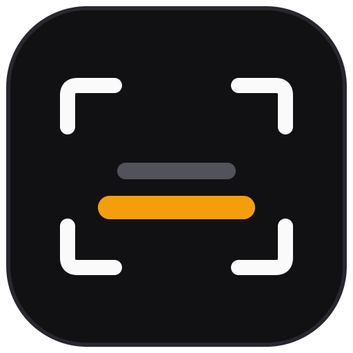
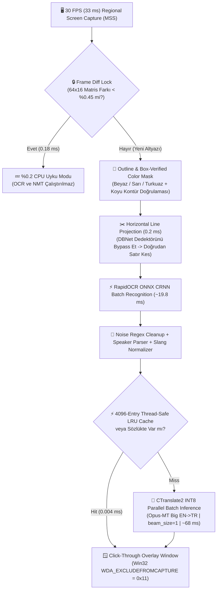

<div align="center">



# ⚡ SubVision AI — Real-Time On-Screen Subtitle Studio (EN ➔ TR)

**Oyunlar, Diziler, Filmler ve Canlı Yayınlar İçin Ultra Düşük Gecikmeli Lokal AI Altyazı Çeviri Motoru**

[-2563EB?style=for-the-badge&logo=windows&logoColor=white)](https://github.com/Andacbasaran/subvision-ai-subtitle-translator/releases/latest)
[](https://www.python.org/)
[](https://pypi.org/project/PyQt6/)
[](https://github.com/OpenNMT/CTranslate2)
[](https://github.com/RapidAI/RapidOCR)
[-10B981?style=for-the-badge)](#)
[](LICENSE)

</div>

---

## ✨ Neden SubVision AI? (Kısa Özet)

**SubVision AI**, ekranda açık olan herhangi bir **PC Oyunu**, **Dizi / Film Platformu** *(Netflix, Prime Video, Disney+, VLC, Blu-ray)* veya **Canlı Yayın / Video** *(YouTube, Twitch, Udemy)* üzerindeki İngilizce altyazıları anlık olarak okuyan, **tamamen kendi bilgisayarınızda (`Offline CPU Inference`)** Türkçeye çeviren ve orijinal altyazının tam üzerine şeffaf bir **`Click-Through Overlay`** olarak yansıtan masaüstü stüdyosudur.

<table>
  <tr>
    <td width="50%">
      <b>⚡ Göz Kırpmasından Hızlı (~88 ms)</b><br/>
      Standart OCR motorlarındaki ağır metin arama katmanını (<code>DBNet</code>) bypass ederek altyazıyı <b>19.8 ms</b>'de okur ve toplam <b>~87.9 ms</b> içinde Türkçeye çevirir.
    </td>
    <td width="50%">
      <b>🛡️ Sıfır FPS Kaybı (0 MB VRAM)</b><br/>
      Ekran kartını (GPU) hiç kullanmaz. Tüm OCR ve NMT işlemleri <code>INT8 Quantization</code> ile işlemci (CPU) üzerinde çalışır; oyunlarda tek bir FPS düşüşüne bile yol açmaz.
    </td>
  </tr>
  <tr>
    <td width="50%">
      <b>👻 Kendi Yazısını Okumayan Akıllı Overlay</b><br/>
      Win32 <code>WDA_EXCLUDEFROMCAPTURE</code> teknolojisi sayesinde Türkçe altyazı kutusu, orijinal İngilizce altyazının tam üstünü kapatsa bile OCR kendi yazdığı Türkçe metni görmez.
    </td>
    <td width="50%">
      <b>🎬 Oyun, Dizi ve Sinema İçin 3 Özel Profil</b><br/>
      Kontürlü oyun/film altyazıları, yarı saydam bantlı dizi altyazıları ve açık zeminli videolar için 3 farklı algılama modu + <b>Çift Dilli (EN + TR) Sinema Modu</b> içerir.
    </td>
  </tr>
</table>

---

## 🖥️ Uygulama Arayüzü (SubVision AI Studio v1.1)

<div align="center">
  
</div>

* **Sol Panel (Canlı Yakalama Stüdyosu):** Yakalanan İngilizce kaynak cümleyi, anlık Türkçe çeviriyi ve geçmiş diyalog akışını milisaniye bazlı gecikme etiketleriyle canlı gösterir.
* **Sağ Panel (Sahne Profili & Overlay Tasarımcısı):** Algılama modunu, altyazı konumunu, renk paletini, yazı boyutunu ve çift dilli sinema modunu **Canlı Önizleme Kutusu** üzerinden anında test ederek özelleştirmenizi sağlar.
* **Üst Telemetri Kartları:** `OCR Yakalama`, `NMT Çeviri`, `Uçtan Uca Gecikme` ve `LRU Cache Hit` oranlarını görsel barlarla gerçek zamanlı raporlar.

---

## 📊 Performans Testleri ve Benchmark Analizi

<div align="center">
  
</div>

### 💡 Bu Benchmark Rakamları Pratikte Ne Anlama Geliyor?

Bir altyazı çeviricinin dizi izlerken veya oyun oynarken **"anlık (gecikmesiz)"** hissettirmesi için insan gözünün algı eşiği **`150 ms`** altıdır:

1. **Yeni Bir Cümle Çıktığında (`87.9 ms`):** Ekrana ilk kez düşen bir İngilizce replik, **`19.8 ms`** içinde okunur ve **`68.0 ms`** içinde Türkçeye çevrilir. Toplam **`87.9 ms`** süre, insanın göz kırpma süresinin (~150-200 ms) yarısıdır; altyazı değiştiği anda Türkçe karşılığını görürsünüz.
2. **Tekrar Eden veya Kalıp Diyaloglarda (`19.8 ms`):** 4096 cümlelik `Thread-Safe LRU Cache` ve hazır diyalog sözlüğü sayesinde çeviri süresi **`0.004 ms`**'ye iner. Toplam yanıt süresi **`19.8 ms`** olur *(60 FPS bir videonun tek bir karesi kadar süre)*.
3. **Altyazı Ekranda Sabit Dururken (`0.18 ms` — `%0.2 CPU`):** `Frame Diff Lock` algoritması her kareyi `0.18 ms`'de kontrol eder. Ekrandaki altyazı değişmediği sürece OCR ve çeviri motorunu uyku modunda tutarak işlemciyi hiç yormaz.

---

### ⚖️ Geleneksel Yaklaşım vs. SubVision AI Karşılaştırması

| Karşılaştırma Kriteri | Geleneksel Yöntem (DBNet OCR + PyTorch FP32) | ⚡ SubVision AI (Fast Line Projection + CT2 INT8) | Pratik Kazanım |
| :--- | :---: | :---: | :--- |
| **Tek Satır OCR Okuma Süresi** | `97.8 ms` – `350+ ms` | **`19.8 ms`** | **4.9x – 6.2x Daha Hızlı Okuma** |
| **Yeni Cümle Uçtan Uca Gecikme** | `300 ms` – `650 ms` *(Hissedilir gecikme)* | **`87.9 ms`** *(Kısa)* / **`144.2 ms`** *(Uzun)* | **< 150 ms Anlık Algı Eşiği Altı** |
| **Önbellekli Uçtan Uca Gecikme** | `100+ ms` | **`19.8 ms`** | **Anında Tepki (`0.004 ms` Cache)** |
| **Harcanan Ekran Kartı Belleği** | `1.2 GB – 2.4 GB VRAM` | **`0 MB VRAM`** | **Oyunlarda Sıfır FPS Kaybı** |
| **Altyazı Sabitken CPU Kullanımı** | Sürekli OCR Taraması (`%25 – %45 CPU`) | **`%0.2 CPU`** (`0.18 ms` Frame Lock) | **Sessiz ve Serin Çalışma** |
| **Model Disk Boyutu** | `~890 MB` (FP32) | **`227 MB`** (INT8 Quantized) | **%74 Daha Az Bellek Ayak İzi** |

### 🔬 Detaylı Pipeline Ölçüm Tablosu *(AMD Ryzen 12-Thread CPU / 6 Active NMT Threads)*

| Pipeline Aşaması | Ortalama Süre | Detay / P95 | Nasıl Çalışır? |
| :--- | :---: | :---: | :--- |
| **1. Frame Diff Lock (Idle Skip)** | **`0.18 ms`** | `P95: 0.19 ms` | `64×16` küçültülmüş matris farkı `< %0.45` ise kareyi anında atlar. |
| **2. Fast Line Projection OCR (1 Satır)** | **`19.83 ms`** | `~21 ms` | `DBNet` dedektörünü atlayıp satırı `0.2 ms`'de keserek doğrudan `CRNN`'e verir. |
| **3. Fast Line Projection OCR (2 Satır)** | **`65.13 ms`** | Tek Batch | İki satırlı altyazıları tek bir `ONNX Runtime` batch çağrısında paralel okur. |
| **4. CTranslate2 INT8 NMT (Kısa Replik)** | **`68.03 ms`** | ~6–8 kelime | `Helsinki-NLP/opus-mt-tc-big-en-tr` (`INT8`, `beam_size=1`, `6 Thread`). |
| **5. CTranslate2 INT8 NMT (Uzun Replik)** | **`124.42 ms`** | ~14–18 kelime | Çok cümleli uzun dizi/film repliklerinde paralel `translate_batch` çıkarımı. |
| **6. LRU Cache & Glossary Lookup** | **`0.0045 ms`** | `0.0032 ms` | RAM önbelleği ve kalıp sözlüğünden model çalıştırmadan anında dönüş. |

> 💡 **Kendi Sisteminizde Test Edin:** Uygulama içindeki **`⚡ Donanım Benchmark`** butonuna tıklayarak, terminalden `python benchmark.py` komutunu çalıştırarak veya `python -m unittest test_pipeline.py -v` ile birim/entegrasyon testlerini koşarak tüm pipeline'ı doğrulayabilirsiniz.

---

## 🧠 Sistem Mimarisi (Pipeline Architecture)



---

## 🧩 Evrensel İşlemci & Bilgisayar Uyumluluğu

**SubVision AI**, farklı işlemci mimarilerine ve eski/yeni tüm bilgisayarlara (`Intel`, `AMD`, `Apple Silicon / ARM64`; 2 çekirdekli ofis laptoplarından çok çekirdekli oyun bilgisayarlarına) otomatik olarak uyum sağlar:

- **Otomatik CPU & Komut Seti (ISA) Algılama (`hardware.py`):** Fiziksel/mantıksal çekirdek sayısı, mimari (`x86_64` / `ARM64`) ve SIMD özellikleri (`SSE4.2`, `AVX`, `AVX2`, `AVX-512`, `VNNI`, `NEON`) açılışta otomatik taranır.
- **Akıllı Hesaplama Tipi Yedeklemesi (Fallback):** İşlemci `INT8` hızlandırmasını desteklemiyorsa uygulama çökmeden otomatik olarak `INT8_FLOAT32` ➔ `INT16` ➔ `FLOAT32` modlarından çalışan en hızlı seçeneğe geçer.
- **3 Uyarlanabilir Performans Profili:** Arayüzden **Otomatik**, **Eko / Eski CPU (15 FPS)**, **Dengeli (24 FPS)** ve **Maksimum Performans (30 FPS)** profilleri seçilebilir; NMT, ONNX Runtime (`RapidOCR`) ve OpenCV iş parçacıkları (`thread`) otomatik sınırlandırılır.
- **2 Aşamalı Ultra Hafif Kare Kilidi & Akıllı Bekleme:** Sabit ekranlarda maskeleme/morfoloji işlemleri tamamen atlanır ve hareketsiz sahnelerde tarama hızı otomatik düşürülerek düşük güçlü işlemciler yorulmaz.
- **Platform, Ekran ve Klasör Yolu Koruması:** Windows 10/11, macOS ve Linux'ta çalışır; `WDA_EXCLUDEFROMCAPTURE` desteklemeyen eski Windows/Linux/macOS sistemlerde kendi yazısını okuma döngüsünü önlemek için overlay otomatik ROI dışına konumlanır. Türkçe karakterli klasör yolları (`Masaüstü` vb.), salt-okunur dizinler ve küçük laptop ekranları (`1366×768` / `%150 DPI`) sorunsuz desteklenir.

---

## 🚀 İndirme ve Kurulum (30 Saniyede Başlayın)

### Seçenek 1: Hazır `.exe` İle Tek Tıkla Çalıştırma *(Windows — Önerilen)*
1. [**📦 GitHub Releases**](https://github.com/Andacbasaran/subvision-ai-subtitle-translator/releases/latest) sayfasından **`SubVisionAI.exe`** dosyasını indirin *(veya güncel kaynak koddan Windows üzerinde `python build_exe.py` ile yeniden derleyin)*.
2. **`SubVisionAI.exe`** dosyasına çift tıklayın.
   *(Bilgisayarınızda Python kurulu olmasa bile gömülü `Bootstrapper`, taşınabilir çalışma ortamını ve `227 MB` boyutundaki çeviri modelini ilk açılışta otomatik olarak indirip kurar).*

### Seçenek 2: Linux & macOS (Intel / Apple Silicon M1–M4) Tek Komutla Başlatma

```bash
git clone https://github.com/Andacbasaran/subvision-ai-subtitle-translator.git
cd subvision-ai-subtitle-translator
./start.sh
```

### Seçenek 3: Kaynak Koddan Manuel Çalıştırma *(Developer Setup)*

```powershell
# 1. Repository'yi klonlayın
git clone https://github.com/Andacbasaran/subvision-ai-subtitle-translator.git
cd subvision-ai-subtitle-translator

# 2. Virtual Environment oluşturun ve aktif edin
python -m venv .venv
.\.venv\Scripts\activate

# 3. Bağımlılıkları yükleyin ve başlatın
pip install -r requirements.txt
python main.py
```

---

## 🎮 3 Adımda Kullanım & Kısayollar

1. **Oyun veya Videoyu Açın:** Oyunlarda görüntü ayarlarından **`Borderless Windowed (Çerçevesiz Pencere)`** modunu seçin; Netflix, YouTube, Prime Video, Twitch veya VLC'de doğrudan videoyu açın.
2. **`F7` Tuşuna Basıp Altyazı Alanını Seçin:** İngilizce altyazıların çıktığı bölgeyi fare ile kutu içine alın.
3. **`F8` Tuşuna Basıp Çeviriyi Başlatın:** Ekrana İngilizce altyazı düştüğü anda Türkçe çevirisi otomatik olarak gösterilir.

| Global Kısayol | Buton | Açıklama |
| :---: | :--- | :--- |
| **`F7`** | 🎯 **Altyazı Alanını Seç** | Oyun veya video içindeyken fare ile altyazı yakalama bölgesini (`ROI`) seçme ekranını açar. |
| **`F8`** | ▶️ **Başlat / Durdur** | İşlemci profiline göre gerçek zamanlı yakalama ve çeviri motorunu başlatır veya durdurur. |
| **`F9`** | 🧪 **Örnek Sahne Simülasyonu** | Dizi, film ve oyunlardan örnek repliklerle hız ve overlay görünüm testi yapar. |
| **`ESC`** | ❌ **Seçimi İptal Et** | Alan seçici (`ROI`) açıkken mevcut seçimi iptal eder. |

---

## 📂 Proje Dizin Yapısı

```text
├── SubVisionAI.exe          # Özel ikonlu, kendi kendini kurabilen (self-bootstrapping) Windows executable
├── main.py                  # PyQt6 Studio arayüzü, KPI telemetri kartları, canlı önizleme ve QThread yönetimi
├── hardware.py              # Evrensel CPU/ISA algılama, uyarlanabilir thread/FPS profili ve platform yardımcıları
├── ocr_engine.py            # MSS regional capture, 2 aşamalı frame diff lock, outline color mask ve RapidOCR ONNX
├── translator.py            # Uyarlanabilir CTranslate2 (INT8/FP32) NMT motoru, model downloader ve LRU Cache
├── overlay_ui.py            # Platforma duyarlı click-through overlay ve multi-monitor 4K DPI ROI selector
├── glossary.py              # OCR noise cleanup, SDH sound filter, ALL-CAPS normalizer, speaker parser ve sözlük
├── benchmark.py             # End-to-end latency benchmark suite ve infografik üretim aracı
├── test_pipeline.py         # Otomatik donanım uyumluluğu, birim ve entegrasyon test paketi (unittest)
├── build_exe.py             # SubVisionAI.exe (C# Win32) ve PyInstaller standalone paket build script'i
├── setup_bootstrap.ps1      # Zero-dependency otomatik Portable Python & paket kurulum script'i (Windows)
├── baslat.bat               # Windows hızlı başlatma script'i
├── start.sh                 # Linux & macOS (Intel / Apple Silicon) otomatik kurulum ve başlatma script'i
├── requirements.txt         # Python bağımlılıkları
└── assets/                  # Uygulama ikonu (.ico/.png), Studio UI preview ve benchmark infografiği
```

---

## 📄 Lisans

Bu proje **[MIT License](LICENSE)** kapsamında lisanslanmıştır.
