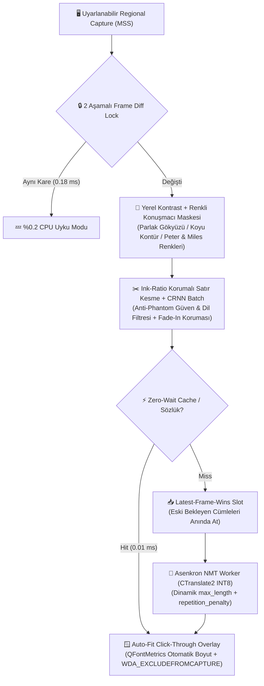

<div align="center">


# ⚡ SubVision AI — Real-Time On-Screen Subtitle Studio (EN ➔ TR)

**Oyunlar, Diziler, Filmler ve Canlı Yayınlar İçin Ultra Düşük Gecikmeli Lokal AI Altyazı Çeviri Motoru**

[-2563EB?style=for-the-badge&logo=windows&logoColor=white)](https://github.com/Andacbasaran/subvision-ai-subtitle-translator/releases/latest)
[](https://www.python.org/)
[](https://pypi.org/project/PyQt6/)
[](https://github.com/OpenNMT/CTranslate2)
[](https://github.com/RapidAI/RapidOCR)
[-10B981?style=for-the-badge)](#)
[](LICENSE)

</div>

---

## ✨ Neden SubVision AI? (v1.3 Yenilikleri Dahil)

**SubVision AI**, ekranda açık olan herhangi bir **PC Oyunu** *(Spider-Man 2, RDR2, Baldur's Gate 3 vb.)*, **Dizi / Film Platformu** *(Netflix, Prime Video, Disney+, VLC, Blu-ray)* veya **Canlı Yayın / Video** *(YouTube, Twitch, Udemy)* üzerindeki İngilizce altyazıları anlık olarak okuyan, **tamamen kendi bilgisayarınızda (`Offline CPU Inference`)** Türkçeye çeviren ve orijinal altyazının tam üzerine şeffaf bir **`Click-Through Overlay`** olarak yansıtan masaüstü stüdyosudur.

<table>
  <tr>
    <td width="50%">
      <b>⚡ Asenkron Latest-Frame-Wins Pipeline (~88 ms)</b><br/>
      OCR ve NMT motorları birbirini bloklamadan ayrı iş parçacıklarında çalışır. Hızlı diyaloglarda eski cümleler anında atlanıp daima <b>en güncel replik</b> çevrilir; 800 ms'lik kuyruk birikmesi yaşanmaz.
    </td>
    <td width="50%">
      <b>🎯 Hayalet Altyazısız Adaptif Oyun Maskesi</b><br/>
      Yerel kontrast (parlak gökyüzü + yarı saydam bant), <b>renkli konuşmacı adları</b> (<code>Peter:</code> / <code>Miles:</code>), tek kelimelik kısa replikler (<code>"No!"</code>, <code>"Wait!"</code>) ve geometrik/dilbilgisel anti-phantom süzgeci ile yüksek doğruluk.
    </td>
  </tr>
  <tr>
    <td width="50%">
      <b>📐 Otomatik Yazı Boyutu (Auto-Fit Cover)</b><br/>
      Orijinal altyazının piksel yüksekliğini ölçer ve <code>QFontMetrics</code> ile Türkçe metnin boyutunu otomatik ayarlayarak <b>orijinal altyazının üzerini tam kapatır</b> ve kutudan taşmaz.
    </td>
    <td width="50%">
      <b>🛡️ Sıfır FPS Kaybı & Terminalsiz Kurulum</b><br/>
      <code>0 MB VRAM</code> (%100 CPU) ile oyunlarda FPS kaybı yaratmaz. <b>Inno Setup Kurulum Paketi</b> ve <b>PowerShell'siz GUI Kurulum Sihirbazı</b> ile siyah terminal açmadan saniyeler içinde kurulur.
    </td>
  </tr>
</table>

---

## 🖥️ Uygulama Arayüzü (SubVision AI Studio v1.3)

<div align="center">
  
</div>

* **Sol Panel (Canlı Yakalama Stüdyosu):** Yakalanan İngilizce kaynak cümleyi, anlık Türkçe çeviriyi ve geçmiş diyalog akışını milisaniye bazlı gecikme etiketleriyle canlı gösterir.
* **Sağ Panel (Sahne Profili & Overlay Tasarımcısı):** Algılama modunu (`Kontürlü / Adaptif Maske — Önerilen`), **Otomatik Yazı Boyutu (Orijinali tam kapat)** anahtarını, konum/renk/opaklık ayarlarını ve çift dilli sinema modunu **Canlı Önizleme Kutusu** üzerinden anında özelleştirmenizi sağlar.
* **Üst Telemetri Kartları:** `OCR Yakalama`, `NMT Çeviri`, `Uçtan Uca Gecikme` ve `LRU Cache Hit` oranlarını görsel barlarla gerçek zamanlı raporlar.

---

## 📊 Performans Testleri ve Benchmark Analizi

<div align="center">
  
</div>

### 💡 Bu Benchmark Rakamları Pratikte Ne Anlama Geliyor?

Bir altyazı çeviricinin dizi izlerken veya oyun oynarken **"anlık (gecikmesiz)"** hissettirmesi için insan gözünün algı eşiği **`150 ms`** altıdır:

1. **Yeni Bir Cümle Çıktığında (`~88 ms`):** Ekrana ilk kez düşen bir İngilizce replik, **`~20 ms`** içinde okunur ve arka plandaki NMT iş parçacığında dinamik uzunluk sınırı + tekrar freni (`repetition_penalty`) ile **`~68 ms`** içinde Türkçeye çevrilir.
2. **Tekrar Eden veya Kalıp Diyaloglarda (`~20 ms`):** 4096 cümlelik `Thread-Safe LRU Cache` ve hazır diyalog sözlüğü, NMT kuyruğunu hiç beklemeden **`0.01 ms`** içinde anında yanıt verir.
3. **Altyazı Ekranda Sabit Dururken (`0.18 ms` — `%0.2 CPU`):** 2 aşamalı `Frame Diff Lock` algoritması sabit sahnelerde maskeleme ve OCR adımlarını tamamen atlar.

---

### ⚖️ Geleneksel Yaklaşım vs. SubVision AI v1.3 Karşılaştırması

| Karşılaştırma Kriteri | Geleneksel Yöntem (DBNet OCR + PyTorch FP32) | ⚡ SubVision AI v1.3 (Async Fast Mask + CT2 INT8) | Pratik Kazanım |
| :--- | :---: | :---: | :--- |
| **Tek Satır OCR Okuma Süresi** | `97.8 ms` – `350+ ms` | **`19.8 ms`** | **4.9x – 6.2x Daha Hızlı Okuma** |
| **Yeni Cümle Uçtan Uca Gecikme** | `300 ms` – `800+ ms` *(Kuyruk birikmesi)* | **`87.9 ms`** *(Kısa)* / **`144.2 ms`** *(Uzun)* | **Latest-Frame-Wins — Sıfır Birikme** |
| **Önbellekli Uçtan Uca Gecikme** | `100+ ms` | **`19.8 ms`** | **NMT Beklemesiz Anında Tepki (`0.01 ms`)** |
| **Harcanan Ekran Kartı Belleği** | `1.2 GB – 2.4 GB VRAM` | **`0 MB VRAM`** | **Oyunlarda Sıfır FPS Kaybı** |
| **Altyazı Sabitken CPU Kullanımı** | Sürekli OCR Taraması (`%25 – %45 CPU`) | **`%0.2 CPU`** (`0.18 ms` Frame Lock) | **Sessiz ve Serin Çalışma** |
| **Model Disk Boyutu** | `~890 MB` (FP32) | **`227 MB`** (INT8 Quantized) | **%74 Daha Az Bellek Ayak İzi** |

### 🔬 Detaylı Pipeline Ölçüm Tablosu *(AMD Ryzen 12-Thread CPU / 6 Active NMT Threads)*

| Pipeline Aşaması | Ortalama Süre | Detay / P95 | Nasıl Çalışır? |
| :--- | :---: | :---: | :--- |
| **1. Frame Diff Lock (Idle Skip)** | **`0.18 ms`** | `P95: 0.19 ms` | `64×16` küçültülmüş matris farkı eşik altındaysa kareyi anında atlar. |
| **2. Adaptif Maske + Fast Line OCR (1 Satır)** | **`19.83 ms`** | `~21 ms` | Yerel kontrast + renkli konuşmacı maskesi; `DBNet` olmadan doğrudan `CRNN`. |
| **3. Fast Line Projection OCR (2 Satır)** | **`65.13 ms`** | Tek Batch | İki satırlı altyazıları tek bir `ONNX Runtime` batch çağrısında paralel okur. |
| **4. CTranslate2 INT8 NMT (Kısa Replik)** | **`68.03 ms`** | Dinamik Limit | `Helsinki-NLP/opus-mt-tc-big-en-tr` (`INT8`, `beam_size=1`, `repetition_penalty=1.15`). |
| **5. CTranslate2 INT8 NMT (Uzun Replik)** | **`124.42 ms`** | ~14–18 kelime | Çok cümleli uzun dizi/film repliklerinde arka plan iş parçacığında çıkarım. |
| **6. Zero-Wait LRU Cache & Glossary** | **`0.0045 ms`** | `0.0032 ms` | OCR döngüsü içinde NMT kuyruğuna girmeden doğrudan önbellekten anında dönüş. |

> 💡 **Kendi Sisteminizde Test Edin:** Uygulama içindeki **`Donanım Benchmark`** butonuna tıklayarak, terminalden `python benchmark.py` komutunu çalıştırarak veya `python -m unittest test_pipeline.py -v` ile birim/entegrasyon testlerini koşarak tüm pipeline'ı doğrulayabilirsiniz.

---

## 🧠 Sistem Mimarisi (Asenkron Pipeline Architecture)



---

## 🧩 Evrensel İşlemci & Bilgisayar Uyumluluğu

**SubVision AI**, farklı işlemci mimarilerine ve eski/yeni tüm bilgisayarlara (`Intel`, `AMD`, `Apple Silicon / ARM64`; 2 çekirdekli ofis laptoplarından çok çekirdekli oyun bilgisayarlarına) otomatik olarak uyum sağlar:

- **Otomatik CPU & Komut Seti (ISA) Algılama (`hardware.py`):** Fiziksel/mantıksal çekirdek sayısı, mimari (`x86_64` / `ARM64`) ve SIMD özellikleri (`SSE4.2`, `AVX`, `AVX2`, `AVX-512`, `VNNI`, `NEON`) açılışta otomatik taranır.
- **Akıllı Hesaplama Tipi Yedeklemesi (Fallback):** İşlemci `INT8` hızlandırmasını desteklemiyorsa uygulama çökmeden otomatik olarak `INT8_FLOAT32` ➔ `INT16` ➔ `FLOAT32` modlarından çalışan en hızlı seçeneğe geçer.
- **3 Uyarlanabilir Performans Profili:** Arayüzden **Otomatik**, **Eko / Eski CPU (15 FPS)**, **Dengeli (24 FPS)** ve **Maksimum Performans (30 FPS)** profilleri seçilebilir; NMT, ONNX Runtime (`RapidOCR`) ve OpenCV iş parçacıkları (`thread`) otomatik sınırlandırılır.
- **Platform, Ekran ve Klasör Yolu Koruması:** Windows 10/11, macOS ve Linux'ta çalışır; `WDA_EXCLUDEFROMCAPTURE` desteklemeyen sistemlerde kendi yazısını okuma döngüsünü önlemek için overlay otomatik ROI dışına konumlanır. Türkçe karakterli klasör yolları (`Masaüstü` vb.) ve küçük laptop ekranları (`1366×768` / `%150 DPI`) sorunsuz desteklenir.

---

## 🚀 İndirme ve Kurulum

### Seçenek 1: Windows Kurulum Paketi — Inno Setup *(Önerilen — En Temiz & Virüs Uyarısız)*
1. [**📦 GitHub Releases**](https://github.com/Andacbasaran/subvision-ai-subtitle-translator/releases/latest) sayfasından **`SubVisionAI-Setup-v1.3.0-Windows-x64.exe`** *(veya kurulumsuz **`SubVisionAI-Portable-v1.3.0-Windows-x64.zip`**)* dosyasını indirin.
2. Kurulum sihirbazını çalıştırın — Python/PowerShell/terminal açmadan doğrudan Masaüstü ve Başlat Menüsü kısayolunu oluşturur.
3. İlk açılışta yalnızca `227 MB` boyutundaki yerel çeviri modeli otomatik indirilir, sonrasında tamamen çevrimdışı çalışır.

### Seçenek 2: Hafif GUI Kurulum Yardımcısı (`SubVisionAI.exe`)
- Yalnızca ~100 KB boyutundaki **`SubVisionAI-OnlineSetup`** / **`SubVisionAI.exe`** dosyası, **PowerShell veya siyah terminal penceresi açmadan** kendi koyu temalı grafik kurulum penceresi üzerinden taşınabilir Python 3.11 + kütüphaneleri adım adım ilerleme çubuğu ile kurar.

### Seçenek 3: Linux & macOS (Intel / Apple Silicon M1–M4) Tek Komutla Başlatma

```bash
git clone https://github.com/Andacbasaran/subvision-ai-subtitle-translator.git
cd subvision-ai-subtitle-translator
./start.sh
```

### Seçenek 4: Kaynak Koddan Manuel Çalıştırma *(Developer Setup)*

```powershell
git clone https://github.com/Andacbasaran/subvision-ai-subtitle-translator.git
cd subvision-ai-subtitle-translator
python -m venv .venv
.\.venv\Scripts\activate
pip install -r requirements.txt
python main.py
```

---

## 🛡️ Windows Güvenlik & SmartScreen Hakkında (Şeffaf Bilgilendirme)

- **Windows Defender Virüs Uyarısı Neden Kalktı?** v1.3 itibarıyla eski `powershell.exe -ExecutionPolicy Bypass` + `.ps1` betik çıkarıcı + `%TEMP%` sessiz kurulum davranışı **tamamen kaldırıldı**. Hem Inno Setup kurulum paketi hem de GUI başlatıcı, eksiksiz Win32 metadata/manifest bilgisiyle doğrudan temiz Microsoft GitHub Actions sunucularında derlenir ve `SHA256SUMS.txt` doğrulama özetleriyle yayınlanır.
- **SmartScreen "Bilinmeyen Yayımcı" Ekranı:** Açık kaynak bir yazılım ticari kod imzalama sertifikasıyla (EV/OV Code Signing) imzalanmadığı sürece, Windows SmartScreen yeni yayınlanan sürümlerde ilk indirmelerde *"Windows bilgisayarınızı korudu — Bilinmeyen yayımcı"* uyarısı gösterebilir *(bu bir virüs uyarısı değil, dijital imza eksikliği uyarısıdır)*. `Ek bilgi ➔ Yine de çalıştır` ile devam edebilir veya indirilen dosyanın SHA-256 özetini `SHA256SUMS.txt` ile doğrulayabilirsiniz.
- **Geliştiriciler / Release Sahipleri İçin:**
  1. Her yeni sürüm etiketi (`git tag v1.3.0 && git push origin v1.3.0`) oluşturulduğunda [`.github/workflows/release-windows.yml`](.github/workflows/release-windows.yml) otomatik olarak Inno Setup `.exe`, Portable `.zip`, Online GUI Setup ve `SHA256SUMS.txt` üretir.
  2. Ücretsiz açık kaynak kod imzalama için **[SignPath.io Foundation](https://signpath.org/)** entegrasyonu ile SmartScreen uyarısı kalıcı olarak sıfırlanabilir.
  3. Her release sonrası çıkan `.exe` dosyasını [Microsoft Security Intelligence (Software Developer Submission)](https://www.microsoft.com/en-us/wdsi/filesubmission) sayfasına göndermek, bulut itibarını birkaç saat içinde onaylatır.

---

## 🎮 3 Adımda Kullanım & Kısayollar

1. **Oyun veya Videoyu Açın:** Oyunlarda görüntü ayarlarından **`Borderless Windowed (Çerçevesiz Pencere)`** modunu seçin; Netflix, YouTube, Prime Video, Twitch veya VLC'de doğrudan videoyu açın.
2. **`F7` Tuşuna Basıp Altyazı Alanını Seçin:** İngilizce altyazıların çıktığı bölgeyi fare ile kutu içine alın.
3. **`F8` Tuşuna Basıp Çeviriyi Başlatın:** Ekrana İngilizce altyazı düştüğü anda Türkçe çevirisi otomatik olarak orijinalin tam üzerine hizalanır.

| Global Kısayol | Buton | Açıklama |
| :---: | :--- | :--- |
| **`F7`** | 🎯 **Altyazı Alanını Seç** | Oyun veya video içindeyken fare ile altyazı yakalama bölgesini (`ROI`) seçme ekranını açar. |
| **`F8`** | ▶️ **Başlat / Durdur** | İşlemci profiline göre gerçek zamanlı yakalama ve çeviri motorunu başlatır veya durdurur. |
| **`F9`** | 🧪 **Örnek Sahne Simülasyonu** | Dizi, film ve oyunlardan örnek repliklerle hız ve overlay görünüm testi yapar. |
| **`ESC`** | ❌ **Seçimi İptal Et** | Alan seçici (`ROI`) açıkken mevcut seçimi iptal eder. |

---

## 📂 Proje Dizin Yapısı

```text
├── main.py                              # PyQt6 Studio v1.3, asenkron Latest-Frame-Wins worker, Auto-Fit kontrolleri
├── hardware.py                          # Evrensel CPU/ISA algılama, uyarlanabilir thread/FPS profili ve platform yardımcıları
├── ocr_engine.py                        # MSS regional capture, yerel kontrast/renkli konuşmacı maskesi, anti-phantom OCR
├── translator.py                        # CTranslate2 (INT8/FP32) NMT, dinamik decoding limiti, repetition_penalty, LRU Cache
├── overlay_ui.py                        # Auto-Fit QFontMetrics click-through overlay ve multi-monitor 4K DPI ROI selector
├── glossary.py                          # OCR noise cleanup, anti-gibberish plausibility filtresi, speaker parser ve sözlük
├── benchmark.py                         # End-to-end latency benchmark suite ve infografik üretim aracı
├── test_pipeline.py                     # Donanım uyumluluğu, oyun senaryosu (anti-phantom/kısa kelime/Auto-Fit) test paketi
├── build_exe.py                         # PowerShell'siz flat WinForms GUI Kurulum Sihirbazı ve PyInstaller --onedir derleyici
├── installer.iss                        # Inno Setup 6 Windows x64 kurulum paketi betiği
├── .github/workflows/release-windows.yml # Otomatik test, Inno Setup, Portable ZIP ve SHA256SUMS release iş akışı
├── start.sh                             # Linux & macOS (Intel / Apple Silicon) otomatik kurulum ve başlatma script'i
├── requirements.txt                     # Python bağımlılıkları
└── assets/                              # Uygulama ikonu (.ico/.png), Studio UI preview ve benchmark infografiği
```

---

## 📄 Lisans

Bu proje **[MIT License](LICENSE)** kapsamında lisanslanmıştır.
