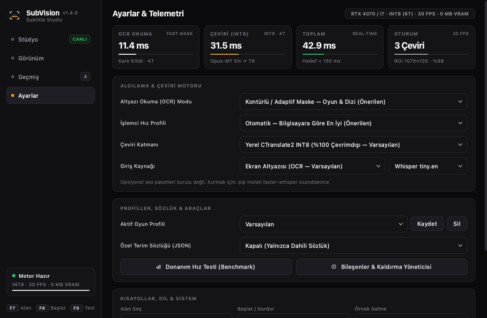

<div align="center">


# ⚡ SubVision AI — Real-Time On-Screen & Live-Audio Subtitle Studio

**🇬🇧 English (Active)** · **🇹🇷 [Türkçe README](README.tr.md)** · **[🎮 Compatibility Matrix](COMPATIBILITY.md)** · **[🤝 Contributing](CONTRIBUTING.md)** · **[🛡️ Security](SECURITY.md)** · **[📜 Changelog](CHANGELOG.md)**

**Ultra-low-latency (~88 ms), 100% offline, 0 MB VRAM real-time English-to-Turkish subtitle translator for PC games, movies, TV shows, and live streams — native on Windows x64 & macOS Apple Silicon.**

[](https://subvisionai.andacbasaran.com/)
[-2563EB?style=for-the-badge&logo=windows&logoColor=white)](https://subvisionai.andacbasaran.com/downloads/SubVisionAI.exe)
[-18181B?style=for-the-badge&logo=apple&logoColor=white)](https://subvisionai.andacbasaran.com/downloads/SubVisionAI-macOS.dmg)
[](https://github.com/Andacbasaran/subvision-ai-subtitle-translator/releases/latest)

[](https://github.com/Andacbasaran/subvision-ai-subtitle-translator/actions/workflows/ci.yml)
[](https://github.com/Andacbasaran/subvision-ai-subtitle-translator/releases/latest)
[](https://github.com/Andacbasaran/subvision-ai-subtitle-translator/releases)
[](https://github.com/Andacbasaran/subvision-ai-subtitle-translator/stargazers)
[](https://www.python.org/)
[-41CD52?style=flat-square&logo=qt&logoColor=white)](https://pypi.org/project/PyQt6/)
[](https://github.com/OpenNMT/CTranslate2)
[-10B981?style=flat-square)](#)
[](LICENSE)

<br/>

[**✨ Why SubVision AI?**](#-why-subvision-ai-whats-new-in-v150) · [**🖥️ Interface**](#️-application-interface) · [**⚖️ Comparison**](#️-how-it-compares) · [**🚀 Download & Install**](#-download--installation) · [**🎮 2-Key Workflow**](#-2-key-workflow--global-hotkeys) · [**📊 Benchmarks**](#-performance-benchmarks) · [**📂 Project Structure**](#-project-structure) · [**🗺️ Roadmap**](#️-roadmap)

</div>

---

## ✨ Why SubVision AI? (What's New in v1.5.0)

**SubVision AI** reads English subtitles in real time from any **PC Game** *(Spider-Man 2, RDR2, Baldur's Gate 3, Cyberpunk 2077)*, **Streaming / Video Player** *(Netflix, Prime Video, VLC, YouTube)*, or **Live Stream** *(Twitch, Udemy)* and renders natural Turkish translations onto a transparent, **click-through overlay** directly over the original text — **100% offline on CPU with 0 MB VRAM**.

<table>
  <tr>
    <td width="50%">
      <b>🎨 Studio 2.0 & Tight-Hugging Subtitles (v1.5.0)</b><br/>
      Redesigned flat dark studio UI with the new <b>Cinema Frame</b> identity. The overlay dynamically measures the original subtitle box and auto-fits Turkish text tightly over it — no bulky boxes, no text overflow.
    </td>
    <td width="50%">
      <b>🍎 Native macOS Apple Silicon (M1–M4) & Windows x64</b><br/>
      Now ships as a native <b>macOS <code>.dmg</code></b> with Cocoa click-through overlay alongside SHA-256 signed Windows <code>.exe</code> / Portable <code>.zip</code> releases and a cross-platform GitHub auto-updater.
    </td>
  </tr>
  <tr>
    <td width="50%">
      <b>⚡ Async Latest-Frame-Wins Pipeline (~88 ms · 0 MB VRAM)</b><br/>
      RapidOCR (<code>~20 ms</code>) and CTranslate2 INT8 NMT (<code>~68 ms</code>) run in decoupled threads. Fast dialogues never queue up; the latest on-screen line always wins. Idle scenes sleep at <code>0.18 ms</code> (<code>0.2% CPU</code>).
    </td>
    <td width="50%">
      <b>🔒 Target-Window Lock, Per-App Profiles & JSON Glossaries</b><br/>
      Automatically hides the overlay when you <code>Alt+Tab</code> away from your game/player, saves per-app ROI & styling profiles, and loads custom game glossaries (<code>glossaries/</code>) for lore-accurate names.
    </td>
  </tr>
  <tr>
    <td width="50%">
      <b>🧠 Optional Context-Aware LLM Layer</b><br/>
      Keep <b>100% offline CTranslate2 INT8</b> by default, or opt into 3-turn sliding dialogue context via local <b>Ollama</b>, <b>Gemini</b>, <b>DeepL</b>, or any <b>OpenAI-compatible</b> endpoint — with instant automatic CT2 fallback.
    </td>
    <td width="50%">
      <b>🎙️ Optional Live Audio Mode (Whisper) & SRT/Anki Export</b><br/>
      Watching an unsubtitled Twitch stream or YouTube video? Enable optional <b>faster-whisper</b> (INT8 CPU) for live speech-to-Turkish subtitles, and export dialogue history to <b>SRT</b> or <b>Anki CSV</b> in one click.
    </td>
  </tr>
</table>

---

## 🖥️ Application Interface

<div align="center">
  
</div>

<details>
<summary><b>📸 View More Screens (Dialogue History & Export · Settings & Live Telemetry)</b></summary>
<br/>
<div align="center">
  <p><b>Tab 2 — Dialogue History (Click to Copy · Export SRT / Anki CSV)</b></p>
  
  <br/><br/>
  <p><b>Tab 3 — Detection, Performance Profiles, Context LLM, Live Telemetry & Benchmark</b></p>
  
</div>
</details>

<!-- Demo GIF slot: drop assets/demo.gif into the repo and uncomment the block below
<div align="center">
  
</div>
-->

> **🎬 Live In-Game Demo GIF (`assets/demo.gif`):** Coming soon! Want to contribute a 10–15 s clip of SubVision AI translating your favorite game? See [CONTRIBUTING.md](CONTRIBUTING.md) or check the [interactive live preview on the official website](https://subvisionai.andacbasaran.com/).

---

## ⚖️ How It Compares

| Feature | ⚡ SubVision AI v1.5.0 | Traditional OCR Translators *(Tesseract / PyTorch FP32)* | Cloud / Paid Screen Translators |
| :--- | :---: | :---: | :---: |
| **End-to-End Latency** | **`~88 ms`** *(~20 ms cached)* | `300 – 800+ ms` *(queue lag)* | `400 – 1,200 ms` *(network)* |
| **GPU / VRAM Usage** | **`0 MB VRAM`** *(100% CPU)* | `1.2 – 2.4 GB VRAM` | Low / Variable |
| **100% Offline & Private** | **Yes** *(default CT2 INT8)* | Yes | No *(cloud API required)* |
| **Platforms** | **Windows x64 · macOS M1–M4 · Linux** | Mostly Windows | Windows / Web |
| **Tight-Hug Overlay & Alt+Tab Lock** | **Yes** *(native Win32 & Cocoa)* | Basic floating box | Basic floating box |
| **Context LLM & Live Audio Whisper** | **Optional** *(Ollama/Gemini/DeepL/OpenAI)* | No | Paid tier only |
| **Pricing & License** | **100% Free & Open Source (MIT)** | Mixed | Subscription / API fees |

---

## 🚀 Download & Installation

### Windows (x64 — Windows 10 / 11)
- **Quick Installer (Recommended):** Download [**SubVisionAI.exe**](https://subvisionai.andacbasaran.com/downloads/SubVisionAI.exe) *(SHA-256 Authenticode signed, includes optional component-level uninstaller)*.
- **Full Setup & Portable Archive:** Download `SubVisionAI-Setup-v1.5.0-Windows-x64.exe` or `SubVisionAI-Portable-v1.5.0-Windows-x64.zip` from [GitHub Releases](https://github.com/Andacbasaran/subvision-ai-subtitle-translator/releases/latest).
- **Package Managers:** Ready-to-use manifests are maintained in [`packaging/winget/`](packaging/winget/) and [`packaging/scoop/`](packaging/scoop/).

### macOS (Apple Silicon M1–M4)
- **Native DMG (Recommended):** Download [**SubVisionAI-macOS.dmg**](https://subvisionai.andacbasaran.com/downloads/SubVisionAI-macOS.dmg) from the website or [GitHub Releases](https://github.com/Andacbasaran/subvision-ai-subtitle-translator/releases/latest), drag **SubVision AI** into `Applications`, and launch.
- **Homebrew Cask:** Cask formula is available under [`packaging/homebrew/`](packaging/homebrew/).
- *First-launch tip:* Grant **Screen Recording** (for regional subtitle capture) and **Accessibility** (for global `F7`/`F8` hotkeys) permissions in *System Settings ➔ Privacy & Security* when prompted.

### Linux & From Source (Developer Setup)
```bash
git clone https://github.com/Andacbasaran/subvision-ai-subtitle-translator.git
cd subvision-ai-subtitle-translator

# Quick launcher (Linux / macOS)
./scripts/start.sh
```

Or set up a virtual environment manually:
```bash
python -m venv .venv
# Windows: .\.venv\Scripts\activate  |  Linux/macOS: source .venv/bin/activate
pip install -r requirements.txt
python main.py
```

#### Optional: Enable Live Audio Mode (Whisper)
```bash
# Cross-platform (microphone / loopback)
pip install -e ".[audio]"

# Windows WASAPI desktop audio loopback
pip install -e ".[audio-windows]"
```

---

## 🎮 2-Key Workflow & Global Hotkeys

1. Open your game in **Borderless Windowed** mode (or open any video player / browser).
2. Press **`F7`** and drag a box around the English subtitle region.
3. Press **`F8`** to start live Turkish translation. Mouse clicks pass straight through the overlay to your game or player.

| Global Hotkey | Action | Description |
| :---: | :--- | :--- |
| **`F7`** | 🎯 **Select Subtitle Region** | Opens the multi-monitor 4K DPI region selector (`ROI`). |
| **`F8`** | ▶️ **Start / Stop** | Toggles real-time OCR or Live Audio translation. |
| **`F9`** | 🧪 **Try Sample Scene** | Tests overlay appearance and translation latency with sample dialogue. |
| **`ESC`** | ❌ **Cancel Selection** | Cancels region selection mode. |

---

## 📊 Performance Benchmarks

<div align="center">
  
</div>

| Pipeline Stage | Average Latency | Notes |
| :--- | :---: | :--- |
| **1. Frame Diff Lock (Idle Skip)** | **`0.18 ms`** | Skips unchanged frames at `0.2% CPU` |
| **2. Adaptive Mask + Fast Line OCR (1 Line)** | **`19.83 ms`** | Direct CRNN batching without heavy DBNet |
| **3. CTranslate2 INT8 NMT (Short Line)** | **`68.03 ms`** | `opus-mt-tc-big-en-tr` INT8, `0 MB VRAM` |
| **4. Zero-Wait LRU Cache & Glossary** | **`0.0045 ms`** | Instant hit without touching NMT thread |

Run the benchmark locally or execute the automated test suite:
```bash
# Hardware & pipeline benchmark
python scripts/benchmark.py

# Full unit & integration test suite
QT_QPA_PLATFORM=offscreen python -m unittest discover -s tests -v
```

---

## 📂 Project Structure

```text
├── main.py                              # PyQt6 Studio 2.0 entry point & MainWindow
├── subvision/                           # Modular core package
│   ├── hardware.py                      # Universal CPU/ISA detection & adaptive runtime tuning
│   ├── ocr_engine.py                    # MSS regional capture, adaptive color mask, anti-phantom RapidOCR
│   ├── translator.py                    # 100% offline CTranslate2 (INT8/FP32) EN -> TR engine + LRU Cache
│   ├── context_translator.py            # Optional 3-turn context layer (Ollama/Gemini/DeepL/OpenAI) + CT2 fallback
│   ├── audio_whisper.py                 # Optional live audio capture (WASAPI/sounddevice) + faster-whisper VAD
│   ├── glossary.py                      # OCR cleanup, anti-gibberish plausibility filter, speaker parser
│   ├── custom_glossary.py               # User & per-game JSON glossary loader
│   ├── overlay_ui.py                    # Tight-hugging click-through overlay (Win32 / Cocoa) & 4K DPI ROI selector
│   ├── window_tracker.py                # Target-window lock (auto-hide on Alt+Tab / focus switch)
│   ├── profiles.py                      # Per-app ROI, appearance & engine profiles
│   ├── exporters.py                     # Dialogue history exporters (SRT & Anki CSV)
│   ├── workers.py                       # Async Latest-Frame-Wins CaptureTranslateWorker, ModelLoader, BenchmarkWorker
│   ├── ui_widgets.py                    # Reusable HiDPI PyQt6 Studio 2.0 widgets & vector icon builders
│   ├── updater.py                       # Cross-platform async GitHub Releases SemVer auto-updater
│   └── i18n.py                          # Lightweight EN / TR interface localization
├── tests/
│   └── test_pipeline.py                 # Automated unit & integration test suite
├── scripts/                             # Launchers (start.sh, baslat.bat), benchmark.py, build_exe.py, build_macos.py
├── packaging/                           # Inno Setup (inno/installer.iss), Winget, Scoop, Homebrew Cask
├── glossaries/                          # Built-in game glossaries (spiderman2.json, baldurs_gate3.json, cyberpunk2077.json)
├── website/                             # Official landing page & Cloudflare Worker download router
├── docs/                                # Documentation & launch resources
├── assets/                              # Cinema Frame icons (.icns/.ico/.png/.svg), UI previews & benchmark charts
└── .github/workflows/                   # Cross-platform CI (ci.yml) & unified Windows + macOS Release (release.yml)
```

---

## 🗺️ Roadmap

- [ ] **Multi-Language Target Pairs (`EN ➔ ES / DE / PT / JA / FR / KO`)** — Pluggable CTranslate2 / OPUS-MT model selector to bring SubVision AI to global gamers & viewers.
- [ ] **Community Glossary Hub** — Expand `glossaries/` with community-contributed RPG, JRPG, and sci-fi term packs.
- [ ] **Linux AppImage / Flatpak & Universal macOS Build** — One-click installers beyond Windows & Apple Silicon.
- [ ] **In-App Live Demo & One-Click Onboarding Wizard** — Zero-friction first-run calibration.

---

## 🤝 Contributing, Support & License

Contributions, game compatibility reports, new glossaries, and language packs are warmly welcome!
- Read [CONTRIBUTING.md](CONTRIBUTING.md) to get started.
- Add tested games or video players to [COMPATIBILITY.md](COMPATIBILITY.md).
- Review [SECURITY.md](SECURITY.md) for privacy guarantees and binary verification details.

If **SubVision AI** helps you enjoy your games or shows, consider giving the repository a **⭐ Star** on GitHub — it helps more players discover the project!

Licensed under the **[MIT License](LICENSE)**.
