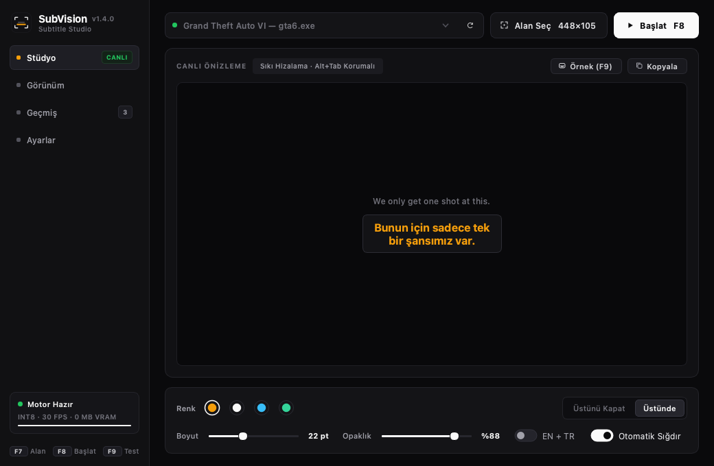
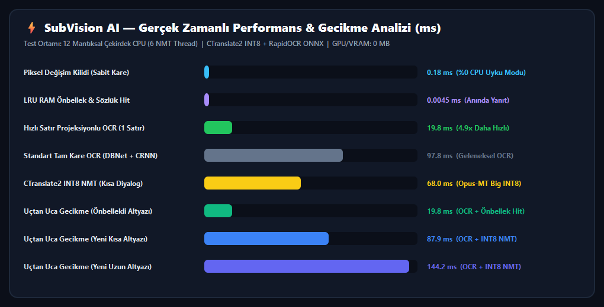
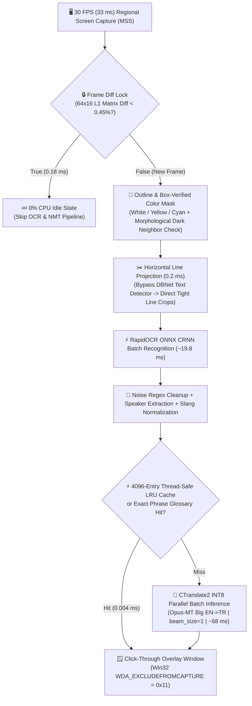

<div align="center">


# ⚡ SubVision AI — Real-Time On-Screen Subtitle Translator (EN ➔ TR)

**Oyunlar, Diziler, Filmler ve Canlı Yayınlar İçin Ultra Düşük Gecikmeli Lokal AI Altyazı Çeviri Motoru**

[-2563EB?style=for-the-badge&logo=github)](https://github.com/Andacbasaran/subvision-ai-subtitle-translator/releases/latest)
[](https://www.python.org/)
[](https://pypi.org/project/PyQt6/)
[](https://github.com/OpenNMT/CTranslate2)
[](https://github.com/RapidAI/RapidOCR)
[-10B981?style=for-the-badge)](#)
[](LICENSE)

</div>

---

## 🎯 Genel Bakış (Overview)

**SubVision AI**, ekranda çalışan herhangi bir **PC Oyunu** *(RPG, Action, Story, Visual Novel)*, **Dizi & Film** *(Netflix, Prime Video, Disney+, VLC, MPC-HC, Blu-ray)* veya **Canlı Yayın / Video** *(YouTube, Twitch, Udemy)* üzerindeki İngilizce altyazıları gerçek zamanlı (*Real-Time*) olarak yakalayan, tamamen **lokal CPU üzerinde (`INT8 Quantization` destekli NMT modeli ile)** Türkçeye çeviren ve şeffaf bir **`Click-Through Overlay`** olarak ekrana yansıtan yüksek performanslı bir masaüstü uygulamasıdır.

* 🛡️ **Zero GPU / VRAM Footprint (`0 MB VRAM`):** Oyunlarda FPS düşüşüne veya frame-time dalgalanmasına yol açmamak için GPU kaynağını kullanmaz; tüm OCR ve NMT `inference` işlemlerini `CTranslate2 INT8` ve `ONNX Runtime` üzerinden CPU üzerinde çalıştırır.
* 🔒 **Anti-Cheat & DRM Safe:** Hiçbir oyun dosyasına, process belleğine veya media player sürecine inject olmaz; yalnızca OS seviyesinde belirlenen **`ROI (Region of Interest)`** alanından ekran yakalama yapar.
* 🌐 **%100 Offline & Self-Hosted Inference:** Harici bir Cloud API anahtarı, rate-limit veya ücretli abonelik gerektirmez.

---

## 🖥️ Uygulama Arayüzü (UI Preview)

<div align="center">
  
</div>

---

## 📊 Performans Testleri ve Latency Analizi (Benchmarks)

Repo içerisindeki **[`benchmark.py`](benchmark.py)** script'i veya arayüzdeki **`📊 Benchmark Testi`** butonu ile kendi donanımınız üzerindeki gerçek **`End-to-End Latency`** metriklerini ölçebilirsiniz.

<div align="center">
  
</div>

### 🧪 Test Ortamı (Hardware Specs)
* **CPU:** AMD Ryzen (`AMD64 Family 25 Model 97`, 12 Logical Cores / `intra_threads=6`)
* **OS:** Windows 10 / 11 x64 (`Build 26300`)
* **NMT Model:** `Helsinki-NLP/opus-mt-tc-big-en-tr` (`CTranslate2 INT8 Quantized` — `227 MB`)
* **OCR Engine:** `RapidOCR (ONNX Runtime CPU)` + Custom `Horizontal Line Projection`
* **GPU / VRAM Usage:** **`0 MB`**

### 1. Pipeline Aşamaları ve End-to-End Latency Tablosu

| Pipeline Stage | Mean Latency | P95 / Detay | Teknik Açıklama |
| :--- | :---: | :---: | :--- |
| **1. Frame Diff Lock (Idle Frame Skip)** | **`0.18 ms`** | `0.19 ms` | `64×16` downsampled L1-norm frame diff; altyazı değişmediğinde OCR ve NMT pipeline'ını tetiklemez. |
| **2. Fast Line Projection OCR (Single-Line)** | **`19.83 ms`** | `~21 ms` | Ağır `DBNet Text Detection` katmanını bypass edip satırı `0.2 ms`'de crop'layarak doğrudan `CRNN Recognizer`'a verir. |
| **3. Fast Line Projection OCR (Multi-Line Batch)** | **`65.13 ms`** | Single Batch | Çok satırlı altyazıları tek bir `ONNX Runtime` batch çağrısında paralel okur. |
| **4. CTranslate2 INT8 NMT (Short Dialogue)** | **`68.03 ms`** | ~6–8 tokens | `INT8 Quantized` Transformer Decoder (`beam_size=1`, `intra_threads=6`). |
| **5. CTranslate2 INT8 NMT (Long Dialogue)** | **`124.42 ms`** | ~14–18 tokens | Çok cümleli dizi/film repliklerinde paralel `translate_batch` inference süresi. |
| **6. Thread-Safe LRU Cache & Glossary Lookup** | **`0.0045 ms`** | `0.0032 ms` | 4096-entry RAM `LRU Cache` ve hazır idiom/phrase tablosu ile sub-millisecond yanıt. |
| **🚀 End-to-End Latency (Warm Cache Hit)** | **`19.83 ms`** | **Instant** | `OCR (19.83 ms) + RAM LRU Cache (0.0045 ms)` |
| **🚀 End-to-End Latency (Cold Short Subtitle)** | **`87.86 ms`** | **Real-Time** | `OCR (19.83 ms) + CTranslate2 INT8 NMT (68.03 ms)` |
| **🚀 End-to-End Latency (Cold Long Subtitle)** | **`144.25 ms`** | **Real-Time** | `OCR (19.83 ms) + CTranslate2 INT8 NMT (124.42 ms)` |

### 2. Geleneksel Mimari ile Karşılaştırma (Baseline vs SubVision AI)

| Metrik / Özellik | Geleneksel Pipeline (DBNet OCR + PyTorch FP32) | ⚡ SubVision AI (Fast Line Projection + CT2 INT8) | Kazanım / Fark |
| :--- | :---: | :---: | :---: |
| **Single-Line OCR Latency (CPU)** | `97.82 ms` – `350+ ms` | **`19.83 ms`** | **4.9x – 6.2x Speedup** |
| **NMT Model Footprint (Disk)** | `~890 MB` (FP32 PyTorch) | **`227 MB`** (INT8 CTranslate2) | **%74 Daha Küçük Model** |
| **GPU VRAM Consumption** | `1.2 GB – 2.4 GB VRAM` | **`0 MB VRAM`** | **Sıfır Oyun FPS Kaybı** |
| **Idle CPU Utilization (Static Frame)** | Sürekli OCR Polling (`%25-%45 CPU`) | **`%0.2 CPU`** (`0.18 ms` Frame Diff Lock) | **Zero Idle Overhead** |
| **Self-Capture Feedback Loop** | Overlay üzerindeki çeviriyi tekrar OCR'a sokar | **`WDA_EXCLUDEFROMCAPTURE` ile %100 İzole** | **In-Place Overlay Coverage** |

---

## 🧠 Sistem Mimarisi (Architecture & Data Flow)



---

## 🔬 Mühendislik ve Optimizasyon Detayları

1. **Win32 `WDA_EXCLUDEFROMCAPTURE (0x11)` Self-Capture Immunity:**
   Standart ekran çeviricilerde Türkçe overlay penceresi orijinal İngilizce altyazının üzerine yerleştirildiğinde, ekran yakalayıcı bir sonraki frame'de kendi render ettiği Türkçe metni yakalayarak feedback loop'a girer. **SubVision AI**, Windows 10/11 `SetWindowDisplayAffinity` API'sini kullanarak overlay penceresini DWM (Desktop Window Manager) capture pipeline'ından hariç tutar. Böylece Türkçe altyazı kutusu orijinal İngilizce altyazının tam üstünü kapatsa bile `MSS` alttaki orijinal görüntüyü yakalamaya devam eder.
2. **DBNet Bypass & `Horizontal Line Projection`:**
   Standart OCR pipeline'larında toplam sürenin `%80`'i metin bounding-box'larını arayan `DBNet Text Detection` modelinde harcanır. SubVision AI, altyazı piksellerinin etrafındaki koyu kontür/gölge komşuluğunu (`Morphological Dilation`) doğrulayarak parlak sahne arka planlarını filtreler; ardından yatay piksel projeksiyon profilinden satır koordinatlarını **`0.2 ms`** içinde çıkarıp doğrudan `CRNN Text Recognizer` katmanına batch olarak besler.
3. **3 Farklı OCR & Scene Detection Profili:**
   * 🎬 **Oyun, Dizi & Film (Hybrid Mode - Önerilen):** Önce `19.8 ms`'lik `Fast Line Projection` filtresini çalıştırır; sahnede kontürsüz özel bir font varsa otomatik olarak `Full-Frame OCR` fallback'ine geçer.
   * ⚡ **Kontürlü Altyazı Modu (Fast Mask Mode):** Yalnızca koyu kontürlü veya koyu arka plan bantlı beyaz/sarı/turkuaz altyazıları okur; oyun içi patlama ve ışık parlamalarında (`bright_ratio > 0.55`) anti-flicker koruması sağlar.
   * 🖥️ **Genel Ekran & Video (Full-Frame OCR Mode):** Açık renk zemin üzerindeki koyu metinler, Visual Novel diyalog kutuları ve masaüstü uygulamaları için `DBNet + CRNN` tam kare okuma modudur.
4. **Speaker-Aware Parsing & Bilingual (EN + TR) Sinema Modu:**
   `Detective: Wait here!` veya `[Arthur] Follow me!` formatındaki repliklerde konuşmacı adını (`Speaker Prefix`) regex ile NMT öncesinde ayırır; karakter isimlerinin yanlış çevrilmesini engeller. Ayrıca dizi/film izleyicileri için Türkçe çevirinin üstünde orijinal İngilizce satırı da gösteren **Bilingual Subtitle** seçeneği sunar.

---

## 🚀 İndirme, Kurulum ve Çalıştırma

### Seçenek 1: GitHub Releases Üzerinden `.exe` İle Çalıştırma (Önerilen)
[**📦 GitHub Releases (v1.0.0)**](https://github.com/Andacbasaran/subvision-ai-subtitle-translator/releases/latest) sayfasından **`SubVisionAI.exe`** veya **`SubVisionAI-v1.0.0-Windows-x64.zip`** paketini indirip doğrudan **`SubVisionAI.exe`** dosyasına çift tıklamanız yeterlidir.
* Sistemde Python kurulu olmasa bile gömülü **`Bootstrapper`** (`setup_bootstrap.ps1`), taşınabilir çalışma ortamını ve `227 MB` boyutundaki `CTranslate2 INT8` modelini ilk açılışta otomatik olarak indirip yapılandırır.

### Seçenek 2: Kaynak Koddan Çalıştırma (Developer Setup)

```powershell
# 1. Repository'yi klonlayın
git clone https://github.com/Andacbasaran/subvision-ai-subtitle-translator.git
cd subvision-ai-subtitle-translator

# 2. Virtual Environment oluşturun ve aktif edin
python -m venv .venv
.\.venv\Scripts\activate

# 3. Bağımlılıkları yükleyin
pip install -r requirements.txt

# 4. Uygulamayı başlatın
python main.py
```

### Seçenek 3: `.exe` Build Alma (`build_exe.py`)

```powershell
# Kök dizinde özel ikonlu ve gömülü kaynak kodlu Windows executable (SubVisionAI.exe) derlemek için:
python build_exe.py

# PyInstaller ile standalone dist/SubVisionAI paketi oluşturmak için:
pip install pyinstaller
python build_exe.py --pyinstaller
```

### CLI Benchmark Suite Çalıştırma

```powershell
python benchmark.py
```

---

## 🎮 Kullanım ve Global Hotkeys

1. **Hedef Uygulamayı Açın:**
   * **Oyunlarda:** Görüntü ayarlarından **`Borderless Windowed`** (Çerçevesiz Pencere) modunu seçin.
   * **Dizi / Film / Yayınlarda:** Netflix, Prime Video, YouTube, Twitch veya VLC/MPC-HC oynatıcınızı açın.
2. **`F7` ile ROI (Altyazı Bölgesi) Seçin:**
   İngilizce altyazıların belirdiği alt bölgeyi fare ile sürükleyerek seçin.
3. **`F8` ile Gerçek Zamanlı Çeviriyi Başlatın:**
   30 FPS (`33 ms`) worker thread seçili alanı izlemeye başlar ve yeni altyazı yakalandığı anda Türkçe overlay ekrana yansıtılır.

| Global Hotkey | İşlev | Açıklama |
| :---: | :--- | :--- |
| **`F7`** | 🎯 **Select ROI** | Oyun veya video içindeyken fare ile altyazı yakalama bölgesini (`ROI`) seçme ekranını açar. |
| **`F8`** | ▶️ **Start / Stop Worker** | 30 FPS gerçek zamanlı capture & translation worker thread'ini başlatır veya durdurur. |
| **`F9`** | 🧪 **Sample Dialogue Test** | Dizi, film ve oyunlardan örnek repliklerle latency ve overlay görünüm testi yapar. |
| **`ESC`** | ❌ **Cancel Selection** | ROI seçici açıkken mevcut seçimi iptal eder. |

---

## 📂 Proje Dizin Yapısı (Directory Structure)

```text
├── SubVisionAI.exe          # Özel ikonlu, kendi kendini kurabilen (self-bootstrapping) Windows executable
├── main.py                  # PyQt6 ana arayüz, KPI telemetri kartları, global hotkey ve QThread yönetimi
├── ocr_engine.py            # MSS regional capture, frame diff lock, outline color mask ve RapidOCR ONNX
├── translator.py            # CTranslate2 INT8 (Opus-MT EN->TR) NMT motoru, model downloader ve Thread-Safe LRU Cache
├── overlay_ui.py            # WDA_EXCLUDEFROMCAPTURE destekli click-through overlay ve multi-monitor 4K DPI ROI selector
├── glossary.py              # OCR noise cleanup, speaker prefix parser, slang normalizer ve exact phrase dictionary
├── benchmark.py             # End-to-end latency benchmark suite ve görsel grafik üretim aracı
├── build_exe.py             # SubVisionAI.exe (C# Win32) ve PyInstaller standalone paket build script'i
├── setup_bootstrap.ps1      # Zero-dependency otomatik Portable Python & paket kurulum script'i
├── baslat.bat               # Hızlı başlatma script'i
├── requirements.txt         # Python bağımlılıkları
└── assets/                  # Uygulama ikonu (.ico/.png), UI preview ve benchmark grafikleri
```

---

## 📄 Lisans (License)

Bu proje **[MIT License](LICENSE)** kapsamında lisanslanmıştır.
