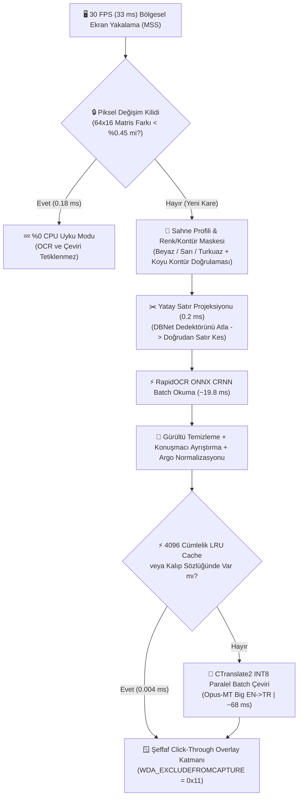

<div align="center">


# ⚡ SubVision AI — Anlık Ekran Altyazı Çevirici (EN ➔ TR)

**Oyunlar, Diziler, Filmler ve Canlı Yayınlar İçin Ultra Düşük Gecikmeli Lokal Yapay Zeka Altyazı Motoru**

[](https://www.python.org/)
[](https://pypi.org/project/PyQt6/)
[](https://github.com/OpenNMT/CTranslate2)
[](https://github.com/RapidAI/RapidOCR)
[-10B981?style=for-the-badge)](#)
[](#)
[](LICENSE)

</div>

---

## 🎯 Proje Hakkında

**SubVision AI**, ekranda oynatılan herhangi bir **PC Oyunu** *(RPG, Aksiyon, Hikâye, Visual Novel)*, **Dizi & Film** *(Netflix, Prime Video, Disney+, VLC, MPC-HC, Blu-ray)* veya **Canlı Yayın / Eğitim Videosu** *(YouTube, Twitch, Udemy)* üzerindeki İngilizce altyazıları gerçek zamanlı olarak yakalayan, tamamen **lokal CPU üzerinde (`INT8` kuantizasyonlu yapay zeka modeli ile)** Türkçeye çeviren ve şeffaf bir katman *(Click-Through Overlay)* olarak ekrana yansıtan yüksek performanslı bir masaüstü uygulamasıdır.

* 🛡️ **Sıfır GPU / VRAM Tüketimi (`0 MB VRAM`):** Oyunlarda tek bir FPS kaybına bile yol açmamak için ekran kartını hiç kullanmaz; tüm OCR ve NMT çıkarımlarını `CTranslate2 INT8` ve `ONNX Runtime` ile işlemci (CPU) üzerinde gerçekleştirir.
* 🔒 **Anti-Cheat & DRM Güvenli:** Hiçbir oyun dosyasına, bellek adresine (RAM) veya tarayıcı/medya oynatıcı sürecine müdahale etmez; yalnızca işletim sistemi ekran görüntüsü katmanından bölgesel okuma yapar.
* 🌐 **%100 Çevrimdışı & Ücretsiz:** Harici bir bulut API anahtarı veya abonelik gerektirmez.

---

## 🖥️ Uygulama Arayüzü

<div align="center">
  
</div>

---

## 📊 Performans Testleri ve Gecikme Analizi (Benchmark)

Uygulama içerisindeki **[`benchmark.py`](benchmark.py)** test paketi veya arayüzdeki **`📊 Benchmark Testi`** butonu ile donanımınız üzerindeki gerçek uçtan uca gecikme sürelerini ölçebilirsiniz.

<div align="center">
  
</div>

### 🧪 Test Ortamı Donanım Özeti
* **İşlemci (CPU):** AMD Ryzen (AMD64 Family 25 Model 97, 12 Mantıksal Çekirdek / 6 Aktif NMT Thread)
* **İşletim Sistemi:** Windows 10 / 11 x64 (`Build 26300`)
* **Çeviri Modeli:** `Helsinki-NLP/opus-mt-tc-big-en-tr` (`CTranslate2 INT8` Kuantize — `227 MB`)
* **OCR Motoru:** `RapidOCR (ONNX Runtime CPU)` + Özel Yatay Satır Projeksiyonu
* **Ekran Kartı (GPU / VRAM) Kullanımı:** **0 MB**

### 1. Aşama Bazlı Uçtan Uca Gecikme Tablosu

| Boru Hattı (Pipeline) Aşaması | Ortalama Süre | P95 / Detay | Mühendislik Açıklaması |
| :--- | :---: | :---: | :--- |
| **1. Piksel Değişim Kilidi (Sabit Kare)** | **`0.18 ms`** | `0.19 ms` | `64×16` L1 önbellek dostu matris farkı; altyazı değişmediğinde OCR ve NMT'yi uyku modunda tutar. |
| **2. Hızlı Satır Projeksiyonlu OCR (1 Satır)** | **`19.83 ms`** | `~21 ms` | Ağır DBNet metin dedektörünü atlayıp satırı `0.2 ms`'de keserek doğrudan CRNN okuyucuya verir. |
| **3. Hızlı Satır Projeksiyonlu OCR (2 Satır)** | **`65.13 ms`** | Tek Batch | Çok satırlı altyazıları tek bir ONNX batch çağrısında paralel okur. |
| **4. CTranslate2 INT8 NMT (Kısa Diyalog)** | **`68.03 ms`** | ~6–8 kelime | `INT8` kuantizasyonlu Transformer декоder (`beam_size=1`, 6 CPU Thread). |
| **5. CTranslate2 INT8 NMT (Uzun Diyalog)** | **`124.42 ms`** | ~14–18 kelime | Çok cümleli uzun dizi/film repliklerinde tek seferde paralel batch çevirisi. |
| **6. LRU RAM Önbellek & Kalıp Sözlüğü** | **`0.0045 ms`** | `0.0032 ms` | 4096 cümlelik Thread-Safe LRU Cache ve hazır diyalog sözlüğü ile anında yanıt. |
| **🚀 Uçtan Uca Toplam (Önbellekli Altyazı)** | **`19.83 ms`** | **Anlık** | `OCR (19.83 ms) + RAM Cache (0.0045 ms)` |
| **🚀 Uçtan Uca Toplam (Yeni Kısa Altyazı)** | **`87.86 ms`** | **Gerçek Zamanlı** | `OCR (19.83 ms) + CTranslate2 INT8 NMT (68.03 ms)` |
| **🚀 Uçtan Uca Toplam (Yeni Uzun Altyazı)** | **`144.25 ms`** | **Gerçek Zamanlı** | `OCR (19.83 ms) + CTranslate2 INT8 NMT (124.42 ms)` |

### 2. Geleneksel Mimari ile Karşılaştırma

| Metrik / Özellik | Geleneksel Yaklaşım (DBNet OCR + PyTorch FP32) | ⚡ SubVision AI (Fast Line Projection + CT2 INT8) | Kazanım / Fark |
| :--- | :---: | :---: | :---: |
| **Tek Satır OCR Süresi (CPU)** | `97.82 ms` – `350+ ms` | **`19.83 ms`** | **4.9x – 6.2x Daha Hızlı** |
| **NMT Model Boyutu (Disk)** | `~890 MB` (FP32 PyTorch) | **`227 MB`** (INT8 CTranslate2) | **%74 Daha Küçük Boyut** |
| **Harcanan GPU VRAM** | `1.2 GB – 2.4 GB VRAM` | **`0 MB VRAM`** | **Sıfır FPS Kaybı** |
| **Altyazı Sabitken CPU Yükü** | Sürekli OCR Taraması (`%25-%45 CPU`) | **`%0.2 CPU`** (`0.18 ms` Piksel Kilidi) | **Gereksiz İşlemci Yükü Yok** |
| **Üst Üste Çeviri (Self-OCR) Sorunu** | Kendi yazdığı Türkçe metni tekrar okur | **`WDA_EXCLUDEFROMCAPTURE` ile %100 Görünmez** | **Orijinal Altyazının Üstünü Kapatabilir** |

---

## 🧠 Sistem Mimarisi ve Veri Akışı



---

## 🔬 Öne Çıkan Mühendislik Optimizasyonları

1. **Windows `WDA_EXCLUDEFROMCAPTURE (0x11)` Görünmezlik Teknolojisi:**
   Geleneksel ekran çeviricilerde Türkçe altyazı kutusu, orijinal İngilizce altyazının üzerine koyulduğunda OCR motoru bir sonraki karede kendi yazdığı Türkçe yazıyı okuyarak sonsuz döngüye girer. **SubVision AI**, Windows 10/11 pencere görüntüleme afinitesi API'sini (`SetWindowDisplayAffinity`) kullanarak Türkçe altyazı penceresini kullanıcının gözüne görünür tutarken ekran yakalama (`mss`) katmanına **%100 görünmez** yapar. Böylece orijinal İngilizce altyazının tam üstünü kapatarak temiz bir sinema deneyimi sunar.
2. **DBNet Bypass & Yatay Satır Projeksiyonu (`Fast Line Projection`):**
   Standart OCR boru hatlarında zamanın `%80`'i metnin ekrandaki koordinatlarını arayan `DBNet` evrişimli ağında harcanır. SubVision AI, altyazı harflerinin etrafındaki koyu kontür/gölge komşuluğunu morfolojik filtrelerle doğrulayarak gökyüzü, patlama veya far gibi parlak arka planları eler; ardından yatay piksel yoğunluk profilinden satırları **`0.2 ms`** içinde kesip doğrudan `CRNN` karakter okuyucusuna gönderir.
3. **3 Farklı İçerik & Sahne Algılama Modu:**
   * 🎬 **Oyun, Dizi & Film (Akıllı Hibrit Filtre - Önerilen):** Önce `19.8 ms`'lik hızlı kontür filtresini dener; eğer sahnede kontürsüz özel bir yazı tipi varsa otomatik olarak tam kare OCR'a geçer.
   * ⚡ **Kontürlü Altyazı Modu (Maksimum Hız):** Yalnızca koyu kontürlü veya koyu bantlı beyaz/sarı/turkuaz altyazıları okur, oyun içi patlama ve flaş parlamalarına karşı koruma sağlar.
   * 🖥️ **Genel Ekran & Video (Tam Kare OCR):** Açık renk zemin üzerindeki siyah metinler, görsel romanlar (Visual Novel) ve masaüstü uygulamaları için tam kare metin arama modudur.
4. **Konuşmacı Koruma (`Speaker-Aware Parsing`) & Çift Dilli Sinema Modu:**
   `Detective: Wait here!` veya `[Arthur] Follow me!` gibi repliklerde karakter adını çeviri motoruna göndermeden ayırır; özel isimlerin yanlış çevrilmesini önler. Ayrıca dizi/film izleyicileri ve dil öğrenenler için Türkçe çevirinin hemen üstünde orijinal İngilizce cümleyi de gösteren **Çift Dilli Altyazı (Bilingual Mode)** seçeneği içerir.

---

## 🚀 Kurulum ve Çalıştırma

### Seçenek 1: Tek Tıkla `.exe` ile Çalıştırma (Önerilen)
Proje klasöründeki **[`SubVisionAI.exe`](SubVisionAI.exe)** (veya **[`baslat.bat`](baslat.bat)**) dosyasına çift tıklamanız yeterlidir.
* Bilgisayarınızda Python veya gerekli kütüphaneler kurulu olmasa bile otomatik önyükleyici (*Bootstrapper*) taşınabilir ortamı ve `~227 MB` boyutundaki `CTranslate2 INT8` çeviri modelini ilk açılışta otomatik olarak indirip hazırlar.

### Seçenek 2: Geliştirici Kurulumu (Python Sanal Ortamı)

```powershell
# 1. Depoyu klonlayın
git clone https://github.com/Andacbasaran/subvision-ai-subtitle-translator.git
cd subvision-ai-subtitle-translator

# 2. Sanal ortam oluşturun ve etkinleştirin
python -m venv .venv
.\.venv\Scripts\activate

# 3. Bağımlılıkları yükleyin
pip install -r requirements.txt

# 4. Uygulamayı başlatın
python main.py
```

### Seçenek 3: Sıfırdan `.exe` Derleme (`build_exe.py`)

```powershell
# Kök dizinde özel ikonlu hızlı Windows başlatıcısını (SubVisionAI.exe) derlemek için:
python build_exe.py

# PyInstaller ile bağımsız (standalone) dist/SubVisionAI klasörü üretmek için:
pip install pyinstaller
python build_exe.py --pyinstaller
```

### Performans Benchmark Testini Terminalden Çalıştırma

```powershell
python benchmark.py
```

---

## 🎮 Kullanım Rehberi ve Global Kısayollar

1. **Oyun veya Dizi/Filmi Açın:**
   * **Oyunlarda:** Görüntü ayarlarından **Çerçevesiz Pencere (Borderless Windowed)** modunu seçin.
   * **Dizi / Film / Yayınlarda:** Netflix, Prime Video, YouTube, Twitch veya VLC/MPC-HC oynatıcınızı açın.
2. **`F7` ile Altyazı Bölgesini Seçin:**
   İngilizce altyazıların çıktığı alt bölgeyi fare ile sürükleyerek kutu içine alın.
3. **`F8` ile Anlık Çeviriyi Başlatın:**
   Ekrana İngilizce altyazı düştüğü anda Türkçe çevirisi otomatik olarak aynı bölgede gösterilir.

| Global Kısayol | İşlev | Açıklama |
| :---: | :--- | :--- |
| **`F7`** | 🎯 **Altyazı Alanını Seç (ROI)** | Oyun veya video içindeyken fare ile altyazı bölgesini seçme ekranını açar. |
| **`F8`** | ▶️ **Çeviriyi Başlat / Durdur** | 30 FPS gerçek zamanlı ekran tarama ve çeviri işçisini başlatır veya durdurur. |
| **`F9`** | 🧪 **Örnek Sahne Testi** | Dizi, film ve oyunlardan örnek diyaloglarla gecikme ve görünüm testi yapar. |
| **`ESC`** | ❌ **Seçimi İptal Et** | Alan seçici (ROI) açıkken mevcut seçimi iptal eder. |

---

## 📂 Proje Dizin Yapısı

```text
├── SubVisionAI.exe          # Özel ikonlu, konsolsuz yerel Windows çalıştırılabilir başlatıcısı
├── main.py                  # PyQt6 ana kontrol paneli, telemetri kartları, kısayol ve iş parçacığı yönetimi
├── ocr_engine.py            # MSS bölgesel yakalama, piksel değişim kilidi, kontür maskesi ve RapidOCR
├── translator.py            # CTranslate2 INT8 (Opus-MT EN->TR) çeviri motoru, otomatik model indirici ve LRU Cache
├── overlay_ui.py            # WDA_EXCLUDEFROMCAPTURE destekli şeffaf altyazı katmanı ve 4K DPI uyumlu ROI seçici
├── glossary.py              # OCR gürültü temizleme, konuşmacı ayrıştırma, argo normalizasyonu ve hızlı sözlük
├── benchmark.py             # Uçtan uca donanım gecikme testi (Benchmark) ve grafik üretim modülü
├── build_exe.py             # SubVisionAI.exe ve PyInstaller standalone paket derleme betiği
├── setup_bootstrap.ps1      # Sıfır bağımlılıklı otomatik Portable Python & kütüphane kurulum sihirbazı
├── baslat.bat               # Hızlı başlatma betiği
├── requirements.txt         # Python paket bağımlılıkları
└── assets/                  # Uygulama ikonu (.ico/.png), arayüz önizlemesi ve benchmark grafikleri
```

---

## 📄 Lisans

Bu proje açık kaynaklı olarak geliştirilmiştir ve eğitim, portfolyo ve kişisel kullanım amaçlarıyla özgürce kullanılabilir.
