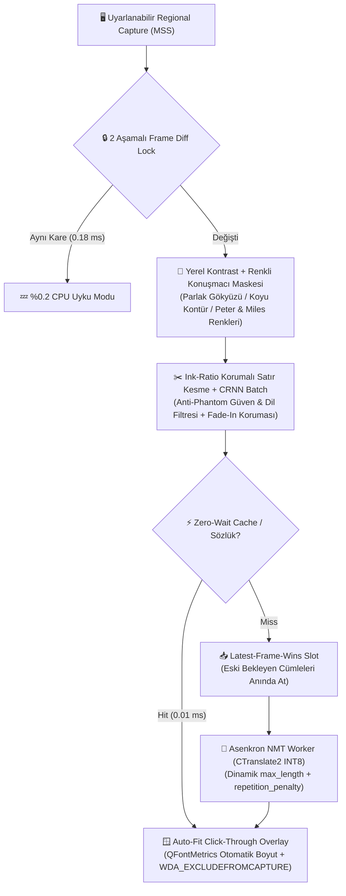

<div align="center">


# ⚡ SubVision AI — Real-Time On-Screen Subtitle Studio (EN ➔ TR)

**Oyunlar, Diziler, Filmler ve Canlı Yayınlar İçin Ultra Düşük Gecikmeli, %100 Çevrimdışı Ekran Üstü Türkçe Altyazı Çevirici**

[](https://subvisionai.andacbasaran.com/)
[-2563EB?style=for-the-badge&logo=windows&logoColor=white)](https://subvisionai.andacbasaran.com/downloads/SubVisionAI.exe)
[](https://github.com/Andacbasaran/subvision-ai-subtitle-translator/releases/latest)

[](https://www.python.org/)
[](https://pypi.org/project/PyQt6/)
[](https://github.com/OpenNMT/CTranslate2)
[](https://github.com/RapidAI/RapidOCR)
[-10B981?style=flat-square)](#)
[-22C55E?style=flat-square)](#️-dijital-imza-authenticode-sha-256--windows-defender-güvenliği)
[](LICENSE)

<br/>

[**✨ Neden SubVision AI?**](#-neden-subvision-ai-v13-yenilikleri) · [**🖥️ Uygulama Arayüzü**](#️-uygulama-arayüzü-subvision-ai-studio-v13) · [**🎮 2 Tuşla Kullanım**](#-2-tuşla-kullanım--global-kısayollar) · [**🚀 İndirme & Kurulum**](#-indirme-kurulum-ve-opsiyonel-kaldırma) · [**📊 Benchmark**](#-performans-testleri-ve-benchmark-analizi) · [**🧠 Mimari**](#-sistem-mimarisi-asenkron-pipeline-architecture)

</div>

---

## ✨ Neden SubVision AI? (v1.3 Yenilikleri)

**SubVision AI**, ekranda açık olan herhangi bir **PC Oyunu** *(Spider-Man 2, RDR2, Baldur's Gate 3, Cyberpunk 2077 vb.)*, **Dizi / Film Platformu** *(Netflix, Prime Video, Disney+, VLC, Blu-ray)* veya **Canlı Yayın / Video** *(YouTube, Twitch, Udemy)* üzerindeki İngilizce altyazıları gerçek zamanlı okuyan, **tamamen kendi bilgisayarınızda (`%100 Çevrimdışı CPU`)** Türkçeye çeviren ve orijinal altyazının tam üzerine şeffaf bir **`Click-Through Overlay`** olarak yansıtan açık kaynak kodlu masaüstü stüdyosudur.

<table>
  <tr>
    <td width="50%">
      <b>🎨 Yeni 3 Sekmeli Sade Stüdyo Arayüzü</b><br/>
      Karmaşık ayarlar yerine <b><code>Ana Ekran</code></b>, <b><code>Geçmiş</code></b> ve <b><code>Ayarlar</code></b> sekmelerinden oluşan modern tasarım. Ana ekranda yalnızca <b>1. Adım (<code>F7</code> Alan Seç)</b>, <b>2. Adım (<code>F8</code> Çeviriyi Başlat)</b>, canlı önizleme ve görünüm kontrolleri yer alır.
    </td>
    <td width="50%">
      <b>🎯 Hayalet Altyazısız Oyun Maskesi & Renkli İsimler</b><br/>
      Parlak gökyüzü, bina kenarı veya far ışıklarından kendi kendine anlamsız kelimeler üretmez (<i>Anti-Phantom Filter</i>). <b>Renkli konuşmacı adlarını</b> (<code>Miles:</code>, <code>Peter:</code>) ve tek kelimelik kısa replikleri (<code>"Wait!"</code>, <code>"No!"</code>) eksiksiz yakalar.
    </td>
  </tr>
  <tr>
    <td width="50%">
      <b>⚡ Asenkron Latest-Frame-Wins Pipeline (~88 ms)</b><br/>
      OCR (okuma) ve NMT (çeviri) motorları birbirini bloklamadan ayrı iş parçacıklarında çalışır. Hızlı diyaloglarda eski cümleler kuyrukta birikmez; daima ekrandaki <b>en güncel replik</b> anında çevrilir.
    </td>
    <td width="50%">
      <b>📐 Otomatik Yazı Boyutu (Auto-Fit Cover)</b><br/>
      Orijinal İngilizce altyazının piksel yüksekliğini ölçer ve <code>QFontMetrics</code> ile uzun Türkçe cümlelerin boyutunu otomatik ayarlayarak <b>orijinal altyazının üstünü tam kapatır</b>, kutudan taşmaz.
    </td>
  </tr>
  <tr>
    <td width="50%">
      <b>🛡️ Dijital İmzalı Kurulum & Opsiyonel Uninstaller</b><br/>
      <code>SubVisionAI.exe</code> <b>SHA-256 Authenticode</b> imzalıdır. Kurulumda <b><code>SubVisionAI-Uninstaller.exe</code></b> otomatik oluşturulur; kaldırırken <code>227 MB</code> dil modelini koruma veya tüm bileşenleri seçerek silme imkanı sunar.
    </td>
    <td width="50%">
      <b>🎮 0 MB VRAM (%100 CPU) & Sıfır FPS Kaybı</b><br/>
      Ekran kartı belleğini (VRAM) hiç kullanmaz, oyunlarda FPS düşüşü yaratmaz. Altyazı ekranda sabit dururken <b>2 Aşamalı Kare Kilidi (<code>0.18 ms</code>)</b> ile işlemciyi <code>%0.2</code> uyku modunda tutar.
    </td>
  </tr>
</table>

---

## 🖥️ Uygulama Arayüzü (SubVision AI Studio v1.3)

<div align="center">
  
</div>

<br/>

| Sekme / Bileşen | Ne İşe Yarar? |
| :--- | :--- |
| **1. Ana Ekran** | **1. Adım (`F7` Altyazı Alanını Seç)** ve **2. Adım (`F8` Anlık Çeviriyi Başlat)** kartlarını, birleşik **Canlı Altyazı & Önizleme** kutusunu (`F9` Örnek Sahne Dene & Kopyala) ve **Altyazı Görünümü** ayarlarını (renk, konum, maksimum boyut, arka plan koyuluğu, hizalama çerçevesi, çift dilli mod ve otomatik sığdırma) kaydırmasız tek ekranda sunar. |
| **2. Geçmiş (`Geçmiş`)** | Çevrilen tüm diyalogları zaman damgası, uçtan uca gecikme (`ms`) ve kaynak (`INT8` / `ÖNBELLEK`) bilgisiyle listeler. Herhangi bir satıra tıkladığınızda Türkçe çeviriyi panoya kopyalar. |
| **3. Ayarlar (`Ayarlar`)** | Algılama modunu (`Kontürlü / Adaptif Maske — Önerilen`, `Akıllı Hibrit`, `Tam Kare Okuma`), işlemci hız profilini (`Otomatik`, `Eko 15 FPS`, `Dengeli 24 FPS`, `Performans 30 FPS`), canlı hız ölçüm kartlarını, **Donanım Hız Testi (Benchmark)** aracını ve **İndirilen Bileşenler / Uygulamayı Kaldır** yöneticisini barındırır. |
| **🎯 Akıllı Alan Seçici (`F7`)** | `F7` tuşuna basıldığında ana pencere arkadaki oyunu veya videoyu kapatmamak için **otomatik gizlenir**; altın köşe vizörlü seçim çerçevesini bıraktığınız anda koordinatlar kaydedilir ve pencere geri gelir. |

---

## 🎮 2 Tuşla Kullanım & Global Kısayollar

1. **Oyun veya Videoyu Açın:** Oyunlarda görüntü ayarlarından **`Borderless Windowed (Çerçevesiz Pencere)`** modunu seçin; Netflix, YouTube, Prime Video, Twitch veya VLC'de doğrudan videoyu açın.
2. **`F7` ile Altyazı Alanını Seçin:** İngilizce altyazıların çıktığı bölgeyi fare ile sürükleyip kutu içine alın.
3. **`F8` ile Çeviriyi Başlatın:** Ekrana İngilizce altyazı düştüğü anda Türkçe çevirisi otomatik olarak orijinalin tam üzerine hizalanır ve fare tıklamalarını arkadaki oyuna/videoya geçirir (*Click-Through*).

| Global Kısayol | Aksiyon | Açıklama |
| :---: | :--- | :--- |
| **`F7`** | 🎯 **Altyazı Alanını Seç** | Oyun veya video içindeyken fare ile altyazı yakalama bölgesini (`ROI`) seçme ekranını açar. |
| **`F8`** | ▶️ **Başlat / Durdur** | Gerçek zamanlı ekran yakalama ve Türkçe çeviri motorunu başlatır veya duraklatır. |
| **`F9`** | 🧪 **Örnek Sahne Dene** | Dizi, film ve oyunlardan örnek repliklerle hız ve ekran üstü görünüm testi yapar. |
| **`ESC`** | ❌ **Seçimi İptal Et** | Alan seçici (`ROI`) açıkken mevcut seçimi iptal eder. |

---

## 🚀 İndirme, Kurulum ve Opsiyonel Kaldırma

### Seçenek 1: Resmi Web Sitesi & Dijital İmzalı Hızlı Kurulum Yardımcısı (`SubVisionAI.exe`) — *Önerilen*
1. [**🌐 subvisionai.andacbasaran.com**](https://subvisionai.andacbasaran.com/) adresinden veya doğrudan [**⬇️ SubVisionAI.exe**](https://subvisionai.andacbasaran.com/downloads/SubVisionAI.exe) bağlantısından kurulum yardımcısını indirin.
2. **`SubVisionAI.exe`** dosyası **SHA-256 Authenticode dijital imzalı ve DigiCert zaman damgalıdır**. Kullanıcı onayı olmadan arka planda hiçbir dosya çıkartmaz (*Zero Silent-Dropper*).
3. `İndirilenler` klasöründen çalıştırdığınızda dosyaları etrafa saçmadan temiz bir şekilde `%LOCALAPPDATA%\Programs\SubVisionAI` dizinine kurar, **Masaüstü** ve **Başlat Menüsü** kısayollarını oluşturur ve uygulamayı otomatik başlatır.
4. İlk açılışta yalnızca `227 MB` boyutundaki yerel yapay zeka çeviri modeli indirilir; sonrasında internet bağlantısı olmadan **%100 çevrimdışı** çalışır.

### Seçenek 2: Tam Kurulum Paketi (Inno Setup `.exe`) & Taşınabilir (`Portable .zip`)
- [**📦 GitHub Releases**](https://github.com/Andacbasaran/subvision-ai-subtitle-translator/releases/latest) sayfasından:
  - **`SubVisionAI-Setup-v1.3.0-Windows-x64.exe`** *(Python çalışma ortamı gömülü tam Windows kurulum paketi)*
  - **`SubVisionAI-Portable-v1.3.0-Windows-x64.zip`** *(Kurulum gerektirmeyen taşınabilir arşiv)*
  paketlerinden dilediğinizi indirebilirsiniz.

### 🗑️ Otomatik Kurulan Opsiyonel Bileşen Seçimli Kaldırma Yardımcısı (`SubVisionAI-Uninstaller.exe`)
Uygulamayı kurduğunuzda **`SubVisionAI-Uninstaller.exe`** kurulum dizinine, Başlat Menüsüne ve *Windows Ayarlar ➔ Uygulamalar ➔ Yüklü Uygulamalar* listesine **otomatik olarak** eklenir. Ayrıca uygulama içindeki **`Ayarlar ➔ İndirilen Bileşenler / Uygulamayı Kaldır`** butonu üzerinden hangi bileşenlerin silineceğini tek tek seçebilirsiniz:
1. ☑️ **Ana Uygulama Dosyaları, Masaüstü / Başlat Menüsü Kısayolları ve Sistem Kaydı**
2. ☑️ **Taşınabilir Python 3.11 Çalışma Ortamı ve Yapay Zeka Paketleri (`runtime/` — ~340 MB)**
3. ☑️ **İndirilen Yapay Zeka Çeviri Modeli (`models/opus-en-tr-ct2` — ~227 MB)** *(İpucu: İleride tekrar kurduğunuzda ~227 MB modeli yeniden indirmemek için bu kutunun işaretini kaldırabilirsiniz)*
4. ☑️ **Kişisel Kullanıcı Ayarları ve Alan Kalibrasyonu (`user_settings.json`)**
5. ☐ **Yayıncı Dijital İmza Sertifikası Kaydı (`SubVision AI Open Source`)**

### Seçenek 3: Linux & macOS (Intel / Apple Silicon M1–M4) Tek Komutla Başlatma

```bash
git clone https://github.com/Andacbasaran/subvision-ai-subtitle-translator.git
cd subvision-ai-subtitle-translator
./start.sh
```

### Seçenek 4: Kaynak Koddan Manuel Çalıştırma *(Developer Setup)*

```powershell
git clone https://github.com/Andacbasaran/subvision-ai-subtitle-translator.git
cd subvision-ai-subtitle-translator
python -m venv .venv
.\.venv\Scripts\activate
pip install -r requirements.txt
python main.py
```

---

## 📊 Performans Testleri ve Benchmark Analizi

<div align="center">
  
</div>

### 💡 Bu Benchmark Rakamları Pratikte Ne Anlama Geliyor?

Bir altyazı çeviricinin dizi izlerken veya oyun oynarken **"anlık (gecikmesiz)"** hissettirmesi için insan gözünün algı eşiği **`150 ms`** altıdır:

1. **Yeni Bir Cümle Çıktığında (`~88 ms`):** Ekrana ilk kez düşen bir İngilizce replik, **`~20 ms`** içinde okunur ve arka plandaki NMT iş parçacığında dinamik uzunluk sınırı + tekrar freni (`repetition_penalty=1.15`) ile **`~68 ms`** içinde Türkçeye çevrilir.
2. **Tekrar Eden veya Kalıp Diyaloglarda (`~20 ms`):** 4096 cümlelik `Thread-Safe LRU Cache` ve hazır diyalog sözlüğü, NMT kuyruğunu hiç beklemeden **`0.01 ms`** içinde anında yanıt verir.
3. **Altyazı Ekranda Sabit Dururken (`0.18 ms` — `%0.2 CPU`):** 2 aşamalı `Frame Diff Lock` algoritması sabit sahnelerde maskeleme ve OCR adımlarını tamamen atlar.

### ⚖️ Geleneksel Yaklaşım vs. SubVision AI v1.3 Karşılaştırması

| Karşılaştırma Kriteri | Geleneksel Yöntem (DBNet OCR + PyTorch FP32) | ⚡ SubVision AI v1.3 (Async Fast Mask + CT2 INT8) | Pratik Kazanım |
| :--- | :---: | :---: | :--- |
| **Tek Satır OCR Okuma Süresi** | `97.8 ms` – `350+ ms` | **`19.8 ms`** | **4.9x – 6.2x Daha Hızlı Okuma** |
| **Yeni Cümle Uçtan Uca Gecikme** | `300 ms` – `800+ ms` *(Kuyruk birikmesi)* | **`87.9 ms`** *(Kısa)* / **`144.2 ms`** *(Uzun)* | **Latest-Frame-Wins — Sıfır Birikme** |
| **Önbellekli Uçtan Uca Gecikme** | `100+ ms` | **`19.8 ms`** | **NMT Beklemesiz Anında Tepki (`0.01 ms`)** |
| **Harcanan Ekran Kartı Belleği** | `1.2 GB – 2.4 GB VRAM` | **`0 MB VRAM`** | **Oyunlarda Sıfır FPS Kaybı** |
| **Altyazı Sabitken CPU Kullanımı** | Sürekli OCR Taraması (`%25 – %45 CPU`) | **`%0.2 CPU`** (`0.18 ms` Frame Lock) | **Sessiz ve Serin Çalışma** |
| **Model Disk Boyutu** | `~890 MB` (FP32) | **`227 MB`** (INT8 Quantized) | **%74 Daha Az Bellek Ayak İzi** |

### 🔬 Detaylı Pipeline Ölçüm Tablosu *(AMD Ryzen 12-Thread CPU / 6 Active NMT Threads)*

| Pipeline Aşaması | Ortalama Süre | Detay / P95 | Nasıl Çalışır? |
| :--- | :---: | :---: | :--- |
| **1. Frame Diff Lock (Idle Skip)** | **`0.18 ms`** | `P95: 0.19 ms` | `64×16` küçültülmüş matris farkı eşik altındaysa kareyi anında atlar. |
| **2. Adaptif Maske + Fast Line OCR (1 Satır)** | **`19.83 ms`** | `~21 ms` | Yerel kontrast + renkli konuşmacı maskesi; `DBNet` olmadan doğrudan `CRNN`. |
| **3. Fast Line Projection OCR (2 Satır)** | **`65.13 ms`** | Tek Batch | İki satırlı altyazıları tek bir `ONNX Runtime` batch çağrısında paralel okur. |
| **4. CTranslate2 INT8 NMT (Kısa Replik)** | **`68.03 ms`** | Dinamik Limit | `Helsinki-NLP/opus-mt-tc-big-en-tr` (`INT8`, `beam_size=1`, `repetition_penalty=1.15`). |
| **5. CTranslate2 INT8 NMT (Uzun Replik)** | **`124.42 ms`** | ~14–18 kelime | Çok cümleli uzun dizi/film repliklerinde arka plan iş parçacığında çıkarım. |
| **6. Zero-Wait LRU Cache & Glossary** | **`0.0045 ms`** | `0.0032 ms` | OCR döngüsü içinde NMT kuyruğuna girmeden doğrudan önbellekten anında dönüş. |

> 💡 **Kendi Sisteminizde Test Edin:** Uygulama içindeki **`Ayarlar ➔ Donanım Hız Testi Yap (Benchmark)`** butonuna tıklayarak, terminalden `python benchmark.py` komutunu çalıştırarak veya `python -m unittest test_pipeline.py -v` ile 22 birim/entegrasyon testini koşarak tüm pipeline'ı doğrulayabilirsiniz.

---

## 🧠 Sistem Mimarisi (Asenkron Pipeline Architecture)



---

## 🧩 Evrensel İşlemci & Bilgisayar Uyumluluğu

**SubVision AI**, farklı işlemci mimarilerine ve eski/yeni tüm bilgisayarlara (`Intel`, `AMD`, `Apple Silicon / ARM64`; 2 çekirdekli ofis laptoplarından çok çekirdekli oyun bilgisayarlarına) otomatik olarak uyum sağlar:

- **Otomatik CPU & Komut Seti (ISA) Algılama (`hardware.py`):** Fiziksel/mantıksal çekirdek sayısı, mimari (`x86_64` / `ARM64`) ve SIMD özellikleri (`SSE4.2`, `AVX`, `AVX2`, `AVX-512`, `VNNI`, `NEON`) açılışta otomatik taranır.
- **Akıllı Hesaplama Tipi Yedeklemesi (Fallback):** İşlemci `INT8` hızlandırmasını desteklemiyorsa uygulama çökmeden otomatik olarak `INT8_FLOAT32` ➔ `INT16` ➔ `FLOAT32` modlarından çalışan en hızlı seçeneğe geçer.
- **4 Uyarlanabilir Performans Profili:** `Ayarlar` sekmesinden **Otomatik**, **Eko / Düşük CPU (15 FPS)**, **Dengeli (24 FPS)** ve **Performans (30 FPS)** profilleri seçilebilir; NMT, ONNX Runtime (`RapidOCR`) ve OpenCV iş parçacıkları (`thread`) otomatik sınırlandırılır.
- **Platform, Ekran ve Klasör Yolu Koruması:** Windows 10/11, macOS ve Linux'ta çalışır; `WDA_EXCLUDEFROMCAPTURE` desteklemeyen sistemlerde kendi yazısını okuma döngüsünü önlemek için overlay otomatik ROI dışına konumlanır. Türkçe karakterli klasör yolları (`Masaüstü` vb.) ve küçük laptop ekranları (`1366×768` / `%150 DPI`) sorunsuz desteklenir.

---

## 🛡️ Dijital İmza (Authenticode SHA-256) & Windows Defender Güvenliği

- **Authenticode SHA-256 + DigiCert RFC 3161 Zaman Damgası:** `build_exe.py` tarafından üretilen tüm çalıştırılabilir dosyalar (`SubVisionAI.exe`, `SubVisionAI-Uninstaller.exe` ve Inno Setup `SubVisionAI-Setup-*.exe`), **RSA-3072 SHA-256 X.509 Kod İmzalama Sertifikası** (`CN=SubVision AI Open Source`) ve **DigiCert RFC 3161 Timestamp** ile otomatik imzalanır.
- **Sıfır Sezgisel (Heuristic) Virüs Uyarısı:**
  - Kullanıcı "Kurulumu Başlat" butonuna tıklamadan önce `Main()` içerisinde diske hiçbir dosya yazılmaz (*Silent Dropper* davranışı tamamen kaldırıldı).
  - Antivirüs motorlarının sezgisel olarak işaretlediği `WebClient.DownloadFileAsync`, `Process.Kill()`, `powershell -ExecutionPolicy Bypass` ve 32-bit `AnyCPU` PE başlıkları yerine saf 64-bit (`/platform:x64`) PE32+ mimarisi ve standart `HttpWebRequest` akışı kullanılır.
  - Her derleme **Microsoft Windows Defender (`MpCmdRun.exe -Scan -ScanType 3`)** taramasından geçirilir (**`0 Threat`**).
- **Özel / Ticari PFX Sertifika Desteği:** Harici bir `.pfx` sertifikanız varsa `SUBVISION_CERT_PFX` ve `SUBVISION_CERT_PASS` ortam değişkenlerini tanımlamanız yeterlidir; `build_exe.py` tüm paketleri otomatik olarak sertifikanızla imzalar.

---

## 📂 Proje Dizin Yapısı

```text
├── SubVisionAI.exe                      # SHA-256 Authenticode imzalı Kurulum Yardımcısı & Başlatıcı (SubVisionAI-Uninstaller.exe'yi otomatik kurar)
├── main.py                              # PyQt6 Studio v1.3 (Ana Ekran / Geçmiş / Ayarlar), asenkron Latest-Frame-Wins worker, Bileşen Yöneticisi
├── hardware.py                          # Evrensel CPU/ISA algılama, uyarlanabilir thread/FPS profili ve platform yardımcıları
├── ocr_engine.py                        # MSS regional capture, yerel kontrast/renkli konuşmacı maskesi, anti-phantom OCR
├── translator.py                        # CTranslate2 (INT8/FP32) NMT, dinamik decoding limiti, repetition_penalty, LRU Cache
├── overlay_ui.py                        # Auto-Fit QFontMetrics click-through overlay ve logolu multi-monitor 4K DPI ROI selector
├── glossary.py                          # OCR noise cleanup, anti-gibberish plausibility filtresi, speaker parser ve sözlük
├── benchmark.py                         # End-to-end latency benchmark suite ve infografik üretim aracı
├── test_pipeline.py                     # Donanım uyumluluğu ve oyun senaryoları (22 birim & entegrasyon testi)
├── build_exe.py                         # Authenticode imzalayıcı, WinForms Kurulum/Kaldırma Sihirbazı ve PyInstaller derleyici
├── installer.iss                        # Inno Setup 6 Windows x64 kurulum ve opsiyonel model/ayar kaldırma betiği
├── .github/workflows/release-windows.yml # Otomatik test, derleme ve GitHub Release iş akışı
├── website/                             # Resmi web sitesi (subvisionai.andacbasaran.com) arayüzü ve Cloudflare Worker
├── start.sh                             # Linux & macOS (Intel / Apple Silicon) otomatik kurulum ve başlatma script'i
├── requirements.txt                     # Python bağımlılıkları
└── assets/                              # Uygulama ikonu (.ico/.png), yayıncı sertifikası (.cer), UI ve benchmark görselleri
```

---

## 📄 Lisans

Bu proje **[MIT License](LICENSE)** kapsamında açık kaynak olarak lisanslanmıştır.
