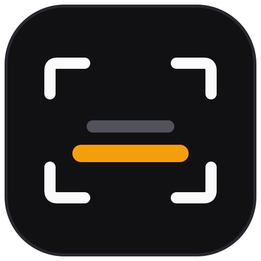
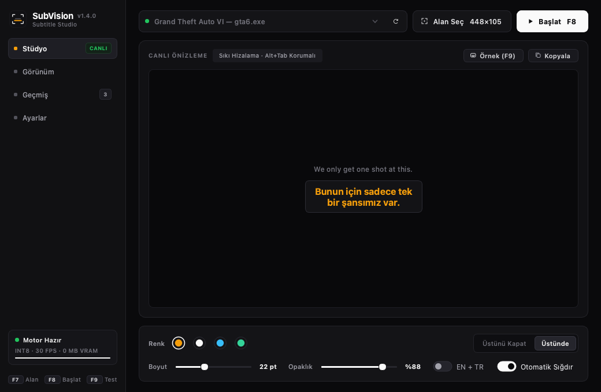
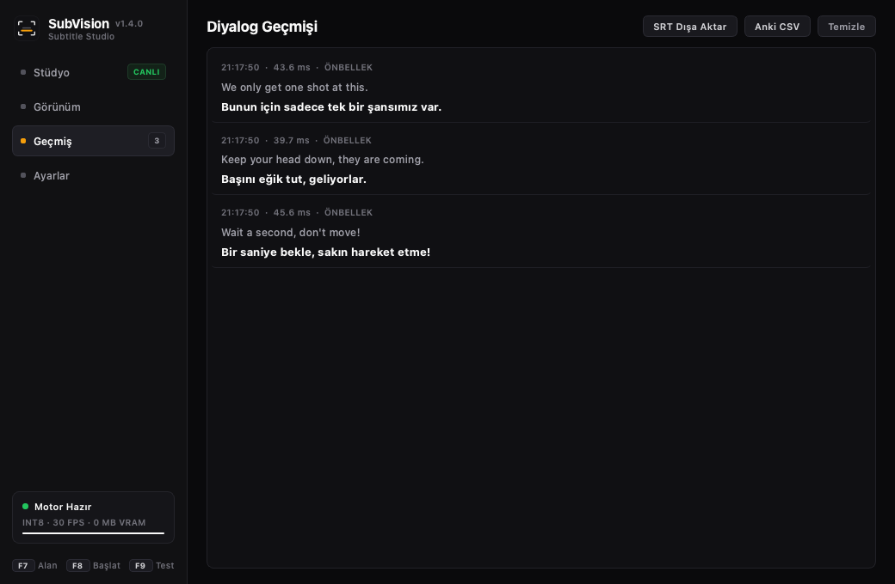
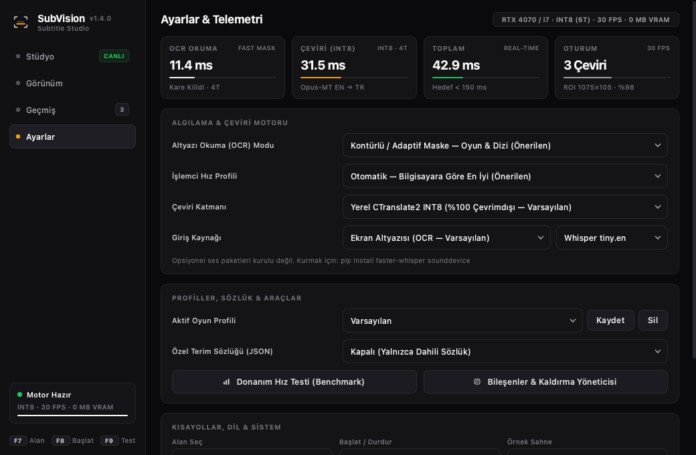
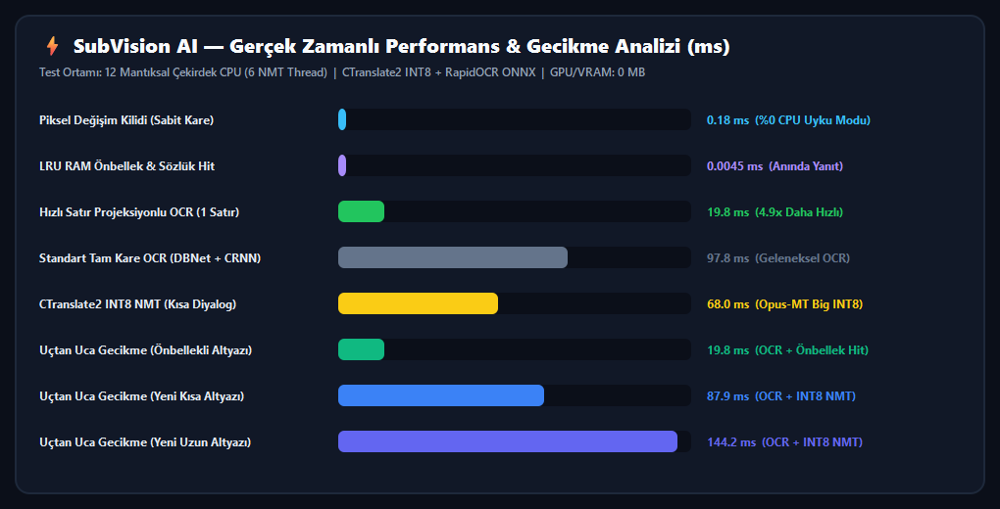
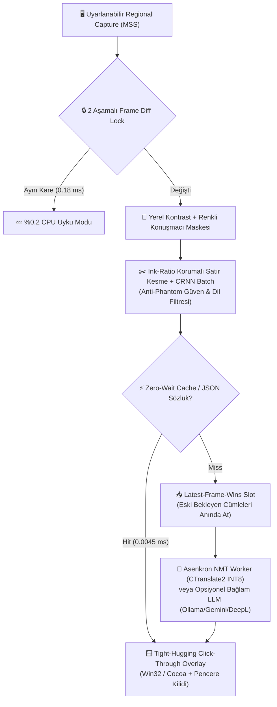

<div align="center">



# ⚡ SubVision AI — Gerçek Zamanlı Ekran Üstü & Canlı Ses Altyazı Stüdyosu (EN ➔ TR)

**🇬🇧 [English README](README.md)** · **🇹🇷 Türkçe (Aktif)** · **[🎮 Uyumluluk Matrisi](COMPATIBILITY.md)** · **[🕹️ Steam Deck Rehberi](docs/STEAM_DECK_GUIDE.md)** · **[🤝 Katkıda Bulun](CONTRIBUTING.md)** · **[🛡️ Güvenlik](SECURITY.md)** · **[📜 Değişiklik Günlüğü](CHANGELOG.md)**

**Oyunlar, Diziler, Filmler ve Canlı Yayınlar İçin Ultra Düşük Gecikmeli (~88 ms), %100 Çevrimdışı, 0 MB VRAM Çok Dilli Ekran Üstü & Canlı Ses Altyazı Çevirici — Windows x64, macOS Apple Silicon (MPS) ve Linux / Steam Deck Yerel Desteğiyle**

[](https://subvisionai.andacbasaran.com/)
[-2563EB?style=for-the-badge&logo=windows&logoColor=white)](https://subvisionai.andacbasaran.com/downloads/SubVisionAI.exe)
[-18181B?style=for-the-badge&logo=apple&logoColor=white)](https://subvisionai.andacbasaran.com/downloads/SubVisionAI-macOS.dmg)
[-E95420?style=for-the-badge&logo=linux&logoColor=white)](https://subvisionai.andacbasaran.com/downloads/SubVisionAI-Linux.tar.gz)
[](https://github.com/Andacbasaran/subvision-ai-subtitle-translator/releases/latest)

[](https://github.com/Andacbasaran/subvision-ai-subtitle-translator/actions/workflows/ci.yml)
[](https://github.com/Andacbasaran/subvision-ai-subtitle-translator/releases/latest)
[](https://github.com/Andacbasaran/subvision-ai-subtitle-translator/releases)
[](https://github.com/Andacbasaran/subvision-ai-subtitle-translator/stargazers)
[](https://www.python.org/)
[-41CD52?style=flat-square&logo=qt&logoColor=white)](https://pypi.org/project/PyQt6/)
[](https://github.com/OpenNMT/CTranslate2)
[-10B981?style=flat-square)](#)
[-22C55E?style=flat-square)](#️-dijital-imza-authenticode-sha-256--windows-defender-güvenliği)
[](LICENSE)

<br/>

[**✨ Neden SubVision AI?**](#-neden-subvision-ai-v160-yenilikleri) · [**🖥️ Arayüz**](#️-uygulama-arayüzü-subvision-ai-studio-20) · [**⚖️ Karşılaştırma**](#️-alternatiflerle-karşılaştırma) · [**🚀 İndirme & Kurulum**](#-indirme-kurulum-ve-opsiyonel-kaldırma) · [**🎮 2 Tuşla Kullanım**](#-2-tuşla-kullanım--global-kısayollar) · [**📊 Benchmark**](#-performans-testleri-ve-benchmark-analizi) · [**🧠 Mimari**](#-sistem-mimarisi-asenkron-pipeline-architecture) · [**🗺️ Yol Haritası**](#️-yol-haritası-roadmap)

</div>

---

## ✨ Neden SubVision AI? (v1.6.0 Yenilikleri)

**SubVision AI**, ekranda açık olan herhangi bir **PC Oyunu** *(Spider-Man 2, Elden Ring, RDR2, The Witcher 3, Baldur's Gate 3, Cyberpunk 2077, Skyrim, Starfield, Persona 5 vb.)*, **Dizi / Film Platformu** *(Netflix, Prime Video, Disney+, VLC, Blu-ray)* veya **Canlı Yayın / Video** *(YouTube, Twitch, Udemy)* üzerindeki altyazıları gerçek zamanlı okuyan, **tamamen kendi bilgisayarınızda (`%100 Çevrimdışı`)** çeviren ve orijinal altyazının tam üzerine şeffaf bir **`Click-Through Overlay`** olarak yansıtan açık kaynak kodlu masaüstü stüdyosudur.

<table>
  <tr>
    <td width="50%">
      <b>🌍 Çoklu Dil Paketi Yöneticisi (v1.6.0)</b><br/>
      Ayarlar içinden tek tıkla <b>8 çevrimdışı dil çifti</b> (<code>EN ➔ TR / ES / DE / FR / PT / RU / IT</code> ve <code>JA ➔ EN</code>) arasında CTranslate2 / OPUS-MT paketlerini indirip geçiş yapın.
    </td>
    <td width="50%">
      <b>🍎 Apple Silicon MPS &amp; 🐧 Linux / Steam Deck (v1.6.0)</b><br/>
      <b>Windows x64</b>, opsiyonel <b>Apple Silicon MPS GPU hızlandırmalı</b> (otomatik CPU yedekli) <b>macOS M1–M4</b> ve <b>Linux / Steam Deck (SteamOS)</b> için yerel paketler — bkz. <a href="docs/STEAM_DECK_GUIDE.md">Steam Deck Rehberi</a>.
    </td>
  </tr>
  <tr>
    <td width="50%">
      <b>📚 Topluluk Sözlük Merkezi &amp; 9 Hazır Oyun Paketi</b><br/>
      Uygulama içi <b>Topluluk Sözlük Merkezi</b> ile terim paketlerini keşfedin; <b>9 yerleşik oyun sözlüğü</b> (<code>elden_ring</code>, <code>rdr2</code>, <code>witcher3</code>, <code>skyrim</code>, <code>starfield</code>, <code>persona5</code>, <code>spiderman2</code>, <code>baldurs_gate3</code>, <code>cyberpunk2077</code>) hazır gelir.
    </td>
    <td width="50%">
      <b>📒 Kelime Defteri &amp; Zengin HTML Anki <code>.tsv</code> Dışa Aktarım</b><br/>
      Oyun veya dizi izlerken karşılaştığınız yeni kelimeleri ve deyimleri <b>Kelime Defteri</b>'ne kaydedin; tek tıkla şık <b>zengin HTML Anki <code>.tsv</code></b> destesi, <b>SRT</b> veya <b>CSV</b> olarak dışa aktarın.
    </td>
  </tr>
  <tr>
    <td width="50%">
      <b>⚡ Asenkron Latest-Frame-Wins Pipeline (~88 ms · 0 MB VRAM)</b><br/>
      RapidOCR (<code>~20 ms</code>) ve CTranslate2 INT8 NMT (<code>~68 ms</code>) ayrı iş parçacıklarında çalışır. Sıkı dinamik hizalama ve <code>Alt+Tab</code> pencere kilidi ile sabit sahnelerde <code>0.18 ms</code> (<code>%0.2 CPU</code>) tüketir.
    </td>
    <td width="50%">
      <b>🧠 Opsiyonel Bağlam LLM &amp; 🎙️ Canlı Ses Modu (Whisper)</b><br/>
      Varsayılan <b>%100 çevrimdışı CTranslate2 INT8</b> motorunu koruyun veya yerel <b>Ollama</b>, <b>Gemini</b>, <b>DeepL</b>, <b>OpenAI</b> bağlam katmanı ile <b>faster-whisper</b> canlı ses çevirisini etkinleştirin.
    </td>
  </tr>
</table>

---

## 🖥️ Uygulama Arayüzü (SubVision AI Studio 2.0)

<div align="center">
  
</div>

<details>
<summary><b>📸 Diğer Sekmelerin Ekran Görüntülerini Gör (2. Diyalog Geçmişi & Dışa Aktarım · 3. Ayarlar & Canlı Telemetri)</b></summary>
<br/>
<div align="center">
  <p><b>2. Sekme — Çevrilen Diyalog Geçmişi (Tıkla & Kopyala · SRT / Anki CSV Dışa Aktar)</b></p>
  
  <br/><br/>
  <p><b>3. Sekme — Algılama, Performans Profili, Bağlam LLM, Canlı Hız Ölçümü & Bileşen Yöneticisi</b></p>
  
</div>
</details>

<!-- Demo GIF alanı: assets/demo.gif eklendiğinde aşağıdaki bloğu açabilirsiniz
<div align="center">
  
</div>
-->

> **🎬 Oyun İçi Canlı Demo GIF (`assets/demo.gif`):** Çok yakında! İnteraktif canlı altyazı önizlemesini hemen [resmi web sitesinde](https://subvisionai.andacbasaran.com/) inceleyebilirsiniz.

<br/>

| Sekme / Bileşen | Ne İşe Yarar? |
| :--- | :--- |
| **1. Ana Ekran** | **1. Adım (`F7` Altyazı Alanını Seç)** ve **2. Adım (`F8` Anlık Çeviriyi Başlat)** kartlarını, birleşik **Canlı Altyazı & Önizleme** kutusunu (`F9` Örnek Sahne Dene & Kopyala) ve **Altyazı Görünümü** ayarlarını (renk, konum, maksimum boyut, arka plan koyuluğu, çift dilli mod, sıkı dinamik sığdırma) tek ekranda sunar. |
| **2. Geçmiş (`Geçmiş`)** | Çevrilen tüm diyalogları zaman damgası, uçtan uca gecikme (`ms`) ve kaynak (`INT8` / `LLM` / `ÖNBELLEK`) bilgisiyle listeler. Satıra tıklayarak kopyalayabilir, tüm listeyi **SRT** veya **Anki CSV** olarak dışa aktarabilirsiniz. |
| **3. Ayarlar (`Ayarlar`)** | Algılama modunu, işlemci hız profilini (`Otomatik`, `Eko 15 FPS`, `Dengeli 24 FPS`, `Performans 30 FPS`), **Uygulama Profillerini**, **Özel JSON Sözlükleri**, **Bağlam LLM / Canlı Ses (Whisper)** ayarlarını, dil seçimini (`TR / EN`), **Donanım Hız Testi (Benchmark)** aracını ve **Bileşen / Kaldırma Yöneticisini** barındırır. |
| **🎯 Akıllı Alan Seçici (`F7`)** | `F7` tuşuna basıldığında ana pencere arkadaki oyunu veya videoyu kapatmamak için **otomatik gizlenir**; çoklu monitör & 4K DPI destekli çerçeveyi bıraktığınız anda koordinatlar kaydedilir. |

---

## ⚖️ Alternatiflerle Karşılaştırma

| Kriter | ⚡ SubVision AI v1.6.0 | Geleneksel OCR Çeviriciler *(Tesseract / PyTorch FP32)* | Bulut / Ücretli Ekran Çeviriciler |
| :--- | :---: | :---: | :---: |
| **Uçtan Uca Gecikme** | **`~88 ms`** *(Önbellekli ~20 ms)* | `300 – 800+ ms` *(Kuyruk birikmesi)* | `400 – 1.200 ms` *(Ağ gecikmesi)* |
| **Ekran Kartı (VRAM) Kullanımı** | **`0 MB VRAM`** *(CPU / opsiyonel Apple MPS)* | `1.2 – 2.4 GB VRAM` | Düşük / Değişken |
| **%100 Çevrimdışı & Gizli** | **Evet** *(8 çevrimdışı dil paketi)* | Evet | Hayır *(Bulut API zorunlu)* |
| **Platform Desteği** | **Windows x64 · macOS M1–M4 · Linux / Steam Deck** | Çoğunlukla Windows | Windows / Web |
| **Sıkı Hizalama & Alt+Tab Kilidi** | **Evet** *(Yerel Win32, Cocoa & X11/Wayland)* | Basit kutu | Basit kutu |
| **Sözlükler, Kelime Defteri & Anki `.tsv`** | **9 Oyun Paketi + Hub + Zengin Anki `.tsv`** | Yok / Manuel | Kısıtlı |
| **Bağlam LLM & Canlı Ses (Whisper)** | **Opsiyonel** *(Ollama/Gemini/DeepL/OpenAI)* | Yok | Yalnızca ücretli plan |
| **Ücret & Lisans** | **%100 Ücretsiz & Açık Kaynak (MIT)** | Karışık | Abonelik / API Ücreti |

---

## 🎮 2 Tuşla Kullanım & Global Kısayollar

1. **Oyun veya Videoyu Açın:** Oyunlarda görüntü ayarlarından **`Borderless Windowed (Çerçevesiz Pencere)`** modunu seçin; Netflix, YouTube, Prime Video, Twitch veya VLC'de doğrudan videoyu açın.
2. **`F7` ile Altyazı Alanını Seçin:** İngilizce altyazıların çıktığı bölgeyi fare ile sürükleyip kutu içine alın.
3. **`F8` ile Çeviriyi Başlatın:** Ekrana İngilizce altyazı düştüğü anda Türkçe çevirisi otomatik olarak orijinalin tam üzerine hizalanır ve fare tıklamalarını arkadaki oyuna/videoya geçirir (*Click-Through*).

| Global Kısayol | Aksiyon | Açıklama |
| :---: | :--- | :--- |
| **`F7`** | 🎯 **Altyazı Alanını Seç** | Oyun veya video içindeyken fare ile altyazı yakalama bölgesini (`ROI`) seçme ekranını açar. |
| **`F8`** | ▶️ **Başlat / Durdur** | Gerçek zamanlı ekran yakalama veya Canlı Ses çeviri motorunu başlatır / duraklatır. |
| **`F9`** | 🧪 **Örnek Sahne Dene** | Dizi, film ve oyunlardan örnek repliklerle hız ve ekran üstü görünüm testi yapar. |
| **`ESC`** | ❌ **Seçimi İptal Et** | Alan seçici (`ROI`) açıkken mevcut seçimi iptal eder. |

---

## 🚀 İndirme, Kurulum ve Opsiyonel Kaldırma

### Seçenek 1: Windows x64 (Windows 10 / 11) — *Önerilen*
1. [**🌐 subvisionai.andacbasaran.com**](https://subvisionai.andacbasaran.com/) adresinden veya doğrudan [**⬇️ SubVisionAI.exe**](https://subvisionai.andacbasaran.com/downloads/SubVisionAI.exe) bağlantısından kurulum yardımcısını indirin.
2. **`SubVisionAI.exe`** dosyası **SHA-256 Authenticode dijital imzalı ve DigiCert zaman damgalıdır**. Kullanıcı onayı olmadan arka planda hiçbir dosya çıkartmaz (*Zero Silent-Dropper*).
3. İlk açılışta yalnızca `227 MB` boyutundaki yerel yapay zeka çeviri modeli indirilir; sonrasında internet bağlantısı olmadan **%100 çevrimdışı** çalışır.
4. Alternatif olarak [**📦 GitHub Releases**](https://github.com/Andacbasaran/subvision-ai-subtitle-translator/releases/latest) sayfasından `SubVisionAI-Setup-v1.6.0-Windows-x64.exe` veya `SubVisionAI-Portable-v1.6.0-Windows-x64.zip` paketlerini indirebilir, ayrıca [`packaging/winget/`](packaging/winget/) ve [`packaging/scoop/`](packaging/scoop/) manifestlerini kullanabilirsiniz.

### Seçenek 2: macOS Apple Silicon (M1 / M2 / M3 / M4)
1. [**⬇️ SubVisionAI-macOS.dmg**](https://subvisionai.andacbasaran.com/downloads/SubVisionAI-macOS.dmg) paketini web sitesinden veya [**📦 GitHub Releases**](https://github.com/Andacbasaran/subvision-ai-subtitle-translator/releases/latest) üzerinden indirin.
2. `.dmg` dosyasını açıp **SubVision AI** uygulamasını `Applications` (Uygulamalar) klasörüne sürükleyin. Otomatik CPU yedeklemeli **Apple Silicon MPS** hızlandırmasını destekler.
3. **Homebrew Cask** formülü [`packaging/homebrew/`](packaging/homebrew/) klasöründe yer alır.
4. *İlk açılış notu:* Ekran yakalama ve global `F7`/`F8` kısayolları için *Sistem Ayarları ➔ Gizlilik ve Güvenlik* altında **Ekran Kaydı** ve **Erişilebilirlik** izinlerini onaylayın.

### Seçenek 3: Linux & Steam Deck (SteamOS)
1. [**⬇️ SubVisionAI-Linux.tar.gz**](https://subvisionai.andacbasaran.com/downloads/SubVisionAI-Linux.tar.gz) (`SubVisionAI-v1.6.0-Linux-x86_64.tar.gz`) paketini indirin, arşivi açın ve `./SubVisionAI` komutuyla başlatın.
2. **Steam Deck / SteamOS:** Masaüstü ve Oyun Modu kurulum adımları için [**🕹️ Steam Deck Rehberi (`docs/STEAM_DECK_GUIDE.md`)**](docs/STEAM_DECK_GUIDE.md) dosyasını inceleyin.

### 🗑️ Otomatik Kurulan Opsiyonel Bileşen Seçimli Kaldırma Yardımcısı (Windows)
Uygulamayı kurduğunuzda **`SubVisionAI-Uninstaller.exe`** kurulum dizinine, Başlat Menüsüne ve *Windows Ayarlar ➔ Uygulamalar* listesine **otomatik olarak** eklenir. Uygulama içindeki **`Ayarlar ➔ İndirilen Bileşenler / Uygulamayı Kaldır`** üzerinden hangi bileşenlerin silineceğini tek tek seçebilirsiniz:
1. ☑️ **Ana Uygulama Dosyaları, Kısayollar ve Sistem Kaydı**
2. ☑️ **Taşınabilir Python Çalışma Ortamı ve Yapay Zeka Paketleri (`runtime/`)**
3. ☑️ **İndirilen Yapay Zeka Çeviri Modeli (`models/opus-en-tr-ct2` — ~227 MB)** *(İleride tekrar kurarken yeniden indirmemek için işaretini kaldırabilirsiniz)*
4. ☑️ **Kişisel Kullanıcı Ayarları, Profiller ve Alan Kalibrasyonu**
5. ☐ **Yayıncı Dijital İmza Sertifikası Kaydı (`SubVision AI Open Source`)**

### Seçenek 4: Kaynak Koddan Çalıştırma *(Developer Setup)*

```bash
git clone https://github.com/Andacbasaran/subvision-ai-subtitle-translator.git
cd subvision-ai-subtitle-translator

# Linux / macOS hızlı başlatıcı
./scripts/start.sh
```

Veya sanal ortam ile manuel kurulum:
```bash
python -m venv .venv
# Windows: .\.venv\Scripts\activate  |  Linux/macOS: source .venv/bin/activate
pip install -r requirements.txt
python main.py
```

#### Opsiyonel: Canlı Ses Modunu (Whisper) Etkinleştirme
```bash
# Çapraz platform (mikrofon / loopback)
pip install -e ".[audio]"

# Windows WASAPI masaüstü ses yakalama
pip install -e ".[audio-windows]"
```

---

## 📊 Performans Testleri ve Benchmark Analizi

<div align="center">
  
</div>

### 💡 Bu Benchmark Rakamları Pratikte Ne Anlama Geliyor?

Bir altyazı çeviricinin dizi izlerken veya oyun oynarken **"anlık (gecikmesiz)"** hissettirmesi için insan gözünün algı eşiği **`150 ms`** altıdır:

1. **Yeni Bir Cümle Çıktığında (`~88 ms`):** Ekrana ilk kez düşen bir İngilizce replik, **`~20 ms`** içinde okunur ve arka plandaki NMT iş parçacığında dinamik uzunluk sınırı + tekrar freni (`repetition_penalty=1.15`) ile **`~68 ms`** içinde Türkçeye çevrilir.
2. **Tekrar Eden veya Kalıp Diyaloglarda (`~20 ms`):** 4096 cümlelik `Thread-Safe LRU Cache` ve hazır diyalog sözlüğü, NMT kuyruğunu hiç beklemeden **`0.0045 ms`** içinde anında yanıt verir.
3. **Altyazı Ekranda Sabit Dururken (`0.18 ms` — `%0.2 CPU`):** 2 aşamalı `Frame Diff Lock` algoritması sabit sahnelerde maskeleme ve OCR adımlarını tamamen atlar.

### 🔬 Detaylı Pipeline Ölçüm Tablosu *(AMD Ryzen 12-Thread CPU / 6 Active NMT Threads)*

| Pipeline Aşaması | Ortalama Süre | Detay / P95 | Nasıl Çalışır? |
| :--- | :---: | :---: | :--- |
| **1. Frame Diff Lock (Idle Skip)** | **`0.18 ms`** | `P95: 0.19 ms` | `64×16` küçültülmüş matris farkı eşik altındaysa kareyi anında atlar. |
| **2. Adaptif Maske + Fast Line OCR (1 Satır)** | **`19.83 ms`** | `~21 ms` | Yerel kontrast + renkli konuşmacı maskesi; `DBNet` olmadan doğrudan `CRNN`. |
| **3. Fast Line Projection OCR (2 Satır)** | **`65.13 ms`** | Tek Batch | İki satırlı altyazıları tek bir `ONNX Runtime` batch çağrısında paralel okur. |
| **4. CTranslate2 INT8 NMT (Kısa Replik)** | **`68.03 ms`** | Dinamik Limit | `Helsinki-NLP/opus-mt-tc-big-en-tr` (`INT8`, `beam_size=1`, `repetition_penalty=1.15`). |
| **5. CTranslate2 INT8 NMT (Uzun Replik)** | **`124.42 ms`** | ~14–18 kelime | Çok cümleli uzun dizi/film repliklerinde arka plan iş parçacığında çıkarım. |
| **6. Zero-Wait LRU Cache & Glossary** | **`0.0045 ms`** | `0.0032 ms` | OCR döngüsü içinde NMT kuyruğuna girmeden doğrudan önbellekten anında dönüş. |

> 💡 **Kendi Sisteminizde Test Edin:** Uygulama içindeki **`Ayarlar ➔ Donanım Hız Testi Yap (Benchmark)`** butonunu kullanabilir veya terminalden testleri çalıştırabilirsiniz:
```bash
python scripts/benchmark.py
QT_QPA_PLATFORM=offscreen python -m unittest discover -s tests -v
```

---

## 🧠 Sistem Mimarisi (Asenkron Pipeline Architecture)



---

## 🧩 Evrensel İşlemci & Bilgisayar Uyumluluğu

**SubVision AI**, farklı işlemci mimarilerine (`Intel`, `AMD`, `Apple Silicon M1–M4 / ARM64`) otomatik uyum sağlar:

- **Otomatik CPU & Komut Seti (ISA) Algılama (`subvision/hardware.py`):** Çekirdek sayısı, mimari (`x86_64` / `ARM64`) ve SIMD özellikleri (`SSE4.2`, `AVX2`, `AVX-512`, `VNNI`, `NEON`) açılışta otomatik taranır.
- **Akıllı Hesaplama Tipi Yedeklemesi:** İşlemci `INT8` hızlandırmasını desteklemiyorsa uygulama çökmeden otomatik olarak `INT8_FLOAT32` ➔ `INT16` ➔ `FLOAT32` moduna geçer.
- **4 Uyarlanabilir Performans Profili:** **Otomatik**, **Eko (15 FPS)**, **Dengeli (24 FPS)** ve **Performans (30 FPS)**.
- **Platform Koruması:** Windows 10/11 (`WDA_EXCLUDEFROMCAPTURE`), macOS Apple Silicon (yerel Cocoa click-through) ve Linux desteği; Türkçe karakterli klasör yolları ve 4K / `%150 DPI` ekranlar sorunsuz desteklenir.

---

## 🛡️ Dijital İmza (Authenticode SHA-256) & Windows Defender Güvenliği

- **Authenticode SHA-256 + DigiCert RFC 3161 Zaman Damgası:** `scripts/build_exe.py` tarafından üretilen Windows paketleri RSA-3072 SHA-256 X.509 Kod İmzalama Sertifikası (`CN=SubVision AI Open Source`) ve DigiCert zaman damgasıyla imzalanır.
- **Sıfır Sezgisel (Heuristic) Virüs Uyarısı:** Kullanıcı onayı olmadan diske hiçbir dosya yazılmaz (*Zero Silent-Dropper*); her derleme **Microsoft Windows Defender** taramasından `0 Threat` sonucuyla geçer.
- **Özel PFX Sertifika Desteği:** `SUBVISION_CERT_PFX` ve `SUBVISION_CERT_PASS` ortam değişkenleriyle harici sertifika kullanılabilir.

---

## 📂 Proje Dizin Yapısı

```text
├── main.py                              # PyQt6 Studio 2.0 giriş noktası ve MainWindow
├── subvision/                           # Modüler çekirdek Python paketi
│   ├── hardware.py                      # Evrensel CPU/ISA + Apple Silicon MPS algılama ve uyarlanabilir thread/FPS profili
│   ├── ocr_engine.py                    # MSS regional capture, adaptif maske ve anti-phantom RapidOCR
│   ├── translator.py                    # %100 çevrimdışı CTranslate2 (INT8/FP32/MPS) NMT motoru + LRU Cache
│   ├── language_packs.py                # Çoklu Dil Paketi Yöneticisi (en-tr/es/de/fr/pt/ru/it + ja-en)
│   ├── context_translator.py            # Opsiyonel 3-turlu bağlam LLM katmanı (Ollama/Gemini/DeepL/OpenAI) + CT2 yedeği
│   ├── audio_whisper.py                 # Opsiyonel canlı ses yakalama (WASAPI/sounddevice) + faster-whisper VAD
│   ├── glossary.py                      # OCR temizleyici, anti-gibberish filtresi ve konuşmacı ayrıştırıcı
│   ├── custom_glossary.py               # Kullanıcı ve oyun bazlı JSON sözlük yükleyici
│   ├── glossary_hub.py                  # Topluluk Sözlük Merkezi tarayıcısı ve paket eşitleyici
│   ├── vocab_learner.py                 # Kişisel Kelime Defteri ve öğrenme takipçisi
│   ├── overlay_ui.py                    # Sıkı dinamik hizalamalı click-through overlay (Win32 / Cocoa / X11) & ROI seçici
│   ├── window_tracker.py                # Hedef pencere kilidi (Alt+Tab otomatik gizleme)
│   ├── profiles.py                      # Uygulama/oyun bazlı ROI ve görünüm profilleri
│   ├── exporters.py                     # Diyalog & Kelime dışa aktarıcıları (SRT, Anki CSV, zengin HTML Anki .tsv)
│   ├── workers.py                       # Asenkron Latest-Frame-Wins iş parçacıkları ve benchmark worker
│   ├── ui_widgets.py                    # HiDPI PyQt6 Studio 2.0 bileşenleri ve vektör ikonlar
│   ├── updater.py                       # Çapraz platform GitHub Releases SemVer otomatik güncelleyici
│   └── i18n.py                          # Hafif EN / TR arayüz yerelleştirme katmanı
├── tests/
│   └── test_pipeline.py                 # Otomatik birim ve entegrasyon test paketi
├── scripts/                             # start.sh, baslat.bat, benchmark.py, build_exe.py, build_macos.py, build_linux.py
├── packaging/                           # Inno Setup (inno/installer.iss), Winget, Scoop, Homebrew Cask
├── glossaries/                          # 9 hazır oyun sözlüğü (elden_ring, rdr2, witcher3, skyrim, starfield, persona5, spiderman2, baldurs_gate3, cyberpunk2077)
├── website/                             # Resmi SEO TR/EN web sitesi (subvisionai.andacbasaran.com) ve Cloudflare Worker
├── docs/                                # Dokümantasyon (STEAM_DECK_GUIDE.md, LAUNCH_PLAYBOOK.md)
├── assets/                              # Cinema Frame ikonları (.icns/.ico/.png/.svg), UI ve benchmark görselleri
└── .github/workflows/                   # Çapraz platform CI (ci.yml) ve birleşik 3-platform Release (release.yml)
```

---

## 🗺️ Yol Haritası (Roadmap)

- [x] **Çoklu Hedef Dil Desteği (`EN ➔ TR / ES / DE / FR / PT / RU / IT` & `JA ➔ EN`)** — Seçilebilir CTranslate2 / OPUS-MT Dil Paketi Yöneticisi v1.6.0 ile eklendi.
- [x] **Topluluk Oyun Sözlüğü Merkezi & 9 Hazır Oyun Paketi** — Elden Ring, RDR2, Witcher 3, Skyrim, Starfield, Persona 5, Spider-Man 2, BG3 ve Cyberpunk 2077 v1.6.0 ile eklendi.
- [x] **Linux & Steam Deck (SteamOS) Paketleme** — Yerel Linux `.tar.gz` paketleri ve Steam Deck kurulum rehberi v1.6.0 ile eklendi.
- [x] **Kelime Defteri & Zengin HTML Anki `.tsv` Dışa Aktarım** — Dil öğrenme iş akışı v1.6.0 ile eklendi.
- [ ] **İlk Açılış Kalibrasyon Sihirbazı** — Yeni kullanıcılar için 10 saniyede hazır kurulum rehberi.
- [ ] **Linux AppImage / Flatpak & Universal macOS Paketi** — Daha fazla tek tıkla kurulum formatı.

---

## 🤝 Katkıda Bulunma & Lisans

Katkılarınız, oyun uyumluluk bildirimleriniz ve yeni oyun sözlükleriniz her zaman değerlidir! [CONTRIBUTING.md](CONTRIBUTING.md) ve [COMPATIBILITY.md](COMPATIBILITY.md) dosyalarına göz atabilirsiniz. Projeyi beğendiyseniz GitHub'da **⭐ Star** vererek destek olabilirsiniz.

Bu proje **[MIT License](LICENSE)** kapsamında açık kaynak olarak lisanslanmıştır.
